<div align="center">

# INFORME TÉCNICO

## Análisis de sentimiento para la evaluación del desempeño docente

### De un sistema de reglas a un modelo predictivo y accionable

<br>

**Proyecto Capstone — Reto Analítica Educativa**<br>
**Samsung Innovation Campus · Universidad del Rosario**

<br>

| | |
|---|---|
| **Equipo** | Tech Tailors |
| **Integrantes** | Juan David Ríos · Natalia Remolina · Giovanni Balza |
| **Fecha** | 4 de agosto de 2026 |
| **Repositorio** | github.com/Capstone-Tech-Tailors/Analitica-Educativa |
| **Modelo de producción** | `modelo_sentimiento_humano` (RoBERTuito + etiquetas humanas) |

</div>

<div style="page-break-after: always;"></div>

## Contenido

| | Sección | |
|---|---|---|
| | **Resumen ejecutivo** | |
| **1** | **Introducción** | 1.1 Contexto del reto · 1.2 Problema · 1.3 Objetivos · 1.4 Alcance |
| **2** | **Idea y arquitectura de la solución** | Pipeline encuesta → sentimiento → tendencia → DOFA → nube |
| **3** | **Datos** | 3.1 Dataset institucional · 3.2 Cadena de derivación del corpus · 3.3 Perfil estadístico · 3.4 Traducción y auditoría · 3.5 Datasets derivados |
| **4** | **Metodología** | 4.1 EDA y auditoría · 4.2 Benchmark · 4.3 Modelo de tendencia · 4.4 Destilación · 4.5 Anotación humana · 4.6 Fine-tuning humano |
| **5** | **RESULTADOS** | 5.1 Benchmark · 5.2 Tendencia · 5.3 Destilación · 5.4 Falsos positivos · 5.5 Anotación · 5.6 Modelo final · 5.7 Auditoría del EDA · 5.8 Análisis institucional · 5.9 Eficiencia · 5.10 Modelos complementarios |
| **6** | **Modelo de producción** | 6.1 Ficha técnica · 6.2 Justificación · 6.3 Verificación · 6.4 Paquete de despliegue |
| **7** | **Despliegue: el sistema en producción** | 7.1 Arquitectura del sistema · 7.2 Cómo se sirve el modelo · 7.3 Requisitos |
| **8** | **Aplicación: del sentimiento al DOFA** | 8.1 Metodología propuesta · 8.2 Implementación en el backend · 8.3 Prototipo real · 8.4 Docentes «enmascarados» |
| **9** | **Limitaciones** | 9.1 Datos · 9.2 Modelo · 9.3 Alcance |
| **10** | **Consideraciones éticas** | |
| **11** | **Conclusiones** | |
| **12** | **Trabajo futuro** | |
| **13** | **Referencias** | |
| **A** | **Anexo A** | Hiperparámetros completos por experimento |
| **B** | **Anexo B** | Glosario |
| **C** | **Anexo C** | Trazabilidad de los resultados |
| **D** | **Anexo D** | Guía de reproducción |

### Índice de figuras

| Fig. | Título | Sección |
|:--:|---|:--:|
| 1 | Los 20 comentarios distintos y su frecuencia en las 3.000 evaluaciones | 3.1 |
| 2 | Desempeño de los modelos preentrenados sobre el gold de 20 | 5.1 |
| 3 | Matrices de confusión del benchmark | 5.1 |
| 4 | Comparación de candidatos del modelo de tendencia | 5.2 |
| 5 | Matriz de confusión del modelo de tendencia | 5.2 |
| 6 | Curva de fiabilidad tras la calibración isotónica | 5.2 |
| 7 | Curvas de aprendizaje de la destilación | 5.3 |
| 8 | Comparación de arquitecturas de estudiante | 5.3 |
| 9 | Compromiso precisión/recall al endurecer el umbral | 5.4 |
| 10 | Desempeño sobre el gold humano de 172 comentarios | 5.6 |
| 11 | Verificación reproducible en el informe ejecutable | 5.6 |
| 12 | Zonas de confusión y aporte del sentimiento | 5.7 |
| 13 | Distribución del sentimiento institucional | 5.8 |
| 14 | Comparación de esquemas de etiquetado | 5.8 |
| 15 | Correlaciones con Egresos a La Fecha | 5.10 |
| 16 | Correlaciones con Estudiantes Aprobados | 5.10 |

<div style="page-break-after: always;"></div>

## Resumen ejecutivo

Este informe documenta el diseño, la construcción, la evaluación y el despliegue de un sistema de
**análisis de sentimiento en español** para los comentarios de las encuestas de evaluación
docente, cuyo propósito final es alimentar la construcción del **DOFA de cada docente** de la
Universidad del Rosario y un modelo complementario de **tendencia de desempeño**
(`Mejora` / `Estable` / `En riesgo`).

El proyecto recorrió el ciclo completo de un desarrollo de ciencia de datos aplicada:

1. **Diagnóstico de datos.** El análisis exploratorio reveló que el dataset institucional del
   reto contiene solo **20 comentarios distintos repetidos en 3.000 filas** (unicidad 0,67 %),
   lo que imposibilita entrenar o evaluar seriamente un modelo de lenguaje. Este hallazgo
   redefinió la estrategia y motivó la incorporación de un corpus real complementario de
   **100.000 comentarios** (29.243 textos únicos), traducido al español por el equipo.
2. **Evaluación comparativa** de tres modelos de sentimiento aplicables al español —RoBERTuito y
   BETO (preentrenados en español) y XLM-R (multilingüe)— contra un estándar de oro manual: RoBERTuito resultó el mejor
   modelo individual (accuracy 0,75) y el consenso por votación el mejor macro-F1 (0,730).
3. **Modelo de tendencia docente**: RandomForest con macro-F1 **0,915** en partición aleatoria y
   **0,905** en validación temporal (entrenar 2020-2022, probar 2023), con detección y exclusión
   de una variable con fuga de información. El punto de operación elegido —tras calibración
   isotónica y umbral 0,21— rinde macro-F1 0,899 con recall `En riesgo` 0,966. Este modelo aún
   no está integrado en el backend (sección 7), que hoy sirve únicamente el de sentimiento.
4. **Fine-tuning por destilación**: se demostró empírica y sistemáticamente que un modelo
   entrenado con pseudo-etiquetas de un maestro **no puede superar al maestro** (fidelidad de
   imitación de hasta 0,933, sin ganancia de calidad real), incluyendo un análisis de falsos
   positivos que probó que el error residual es un problema de **definición de rúbrica** y no de
   modelado.
5. **Anotación humana**: el equipo diseñó y ejecutó un protocolo formal de etiquetado
   (335 comentarios, 3 anotadores independientes, 749 anotaciones) con acuerdo inter-anotador
   **α de Krippendorff = 0,585** y un estándar de oro adjudicado de **172 comentarios**, 8,6
   veces mayor que el disponible previamente.
6. **Modelo final**: el ajuste fino de RoBERTuito con las etiquetas humanas produce el **mejor
   clasificador disponible** sobre la evaluación humana (macro-F1 **0,646**; accuracy 0,762;
   recall de comentarios negativos 0,556), superando de manera consistente —aunque aún no
   estadísticamente significativa (McNemar p = 1,0)— al mejor modelo público (0,638).

El modelo final se empaquetó en un ZIP de 404 MB (modelo en disco: 437 MB, ejecutable en CPU) y
está integrado en el **sistema en producción del equipo**: un backend FastAPI (`src/app.py` del
repositorio) con despliegue continuo en **Azure Container Apps**, que expone los endpoints
`/predecir_sentimientos` y `/analisis_foda` y alimenta un dashboard en PowerBI. Queda pendiente
cargar los pesos en el almacenamiento del contenedor. El informe documenta ese sistema (sección
7), la metodología de construcción del DOFA con su implementación real (sección 8, con un
prototipo sobre datos reales) y una declaración exhaustiva de limitaciones, entre ellas que el
cuello de botella actual es el **volumen de anotación humana**, con el sistema para ampliarla ya
construido y operativo.

<div style="page-break-after: always;"></div>

## 1 · Introducción

### 1.1 Contexto del reto

El reto *Analítica Educativa* plantea evolucionar el análisis de las evaluaciones docentes desde
un sistema descriptivo basado en reglas hacia una solución **predictiva y accionable**, capaz de
anticipar tendencias en el desempeño docente y generar recomendaciones de mejora continua,
manteniendo compatibilidad con los datos y procesos existentes.

### 1.2 Problema

Las encuestas de evaluación docente combinan **puntajes numéricos** (claridad, metodología,
evaluación) con **comentarios de texto libre**. Los puntajes se procesan de forma rutinaria; los
comentarios —que contienen la información más rica y accionable— quedan habitualmente sin
explotar, porque requieren lectura humana masiva o tecnología de procesamiento de lenguaje
natural. El problema abordado es doble:

1. **Clasificar automáticamente el sentimiento** de cada comentario (positivo / neutro /
   negativo) con calidad suficiente para agregarlo por docente.
2. **Predecir la tendencia de desempeño** combinando puntajes y sentimiento, para priorizar el
   acompañamiento pedagógico.

### 1.3 Objetivos

| # | Objetivo | Estado |
|---|---|---|
| O1 | Diagnosticar la calidad e idoneidad de los datos disponibles | ✅ Cumplido (sección 3) |
| O2 | Evaluar comparativamente modelos de sentimiento preentrenados en español | ✅ Cumplido (sección 5.1) |
| O3 | Construir un modelo de tendencia docente validado temporalmente | ✅ Cumplido (sección 5.2) |
| O4 | Ajustar (*fine-tuning*) un modelo de sentimiento propio | ✅ Cumplido (secciones 5.3 a 5.6) |
| O5 | Construir un estándar de oro humano con acuerdo medido | ✅ Cumplido (sección 5.5) |
| O6 | Empaquetar y desplegar el modelo en la nube | ✅ Empaquetado; backend con CI/CD en Azure Container Apps; carga de los pesos al contenedor pendiente (sección 7) |
| O7 | Definir la metodología sentimiento → DOFA | ✅ Cumplido, con prototipo (sección 8) |

### 1.4 Alcance y no-alcance

**Incluye:** análisis exploratorio y auditoría del dataset institucional; benchmark de modelos;
modelo de tendencia; dos rondas de fine-tuning (destilación y verdad humana); protocolo completo
de anotación humana; empaquetado del modelo y documentación del despliegue en producción
(sección 7); metodología DOFA con implementación y prototipo.

**No incluye:** el desarrollo del backend y del dashboard (obra del equipo de backend, aunque la
sección 7 documenta cómo ese sistema sirve el modelo), la integración con el sistema de encuestas
real de la universidad, ni el análisis basado en aspectos (ABSA), que el corpus utilizado no
permite (sección 3.2).

## 2 · Idea y arquitectura de la solución

La solución es un **pipeline de dos modelos complementarios** cuyas salidas agregadas alimentan
el DOFA del docente:

```
                     ┌──────────────────────────────────────────────────────┐
                     │                ENCUESTA DE EVALUACIÓN                │
                     │        puntajes (1–5)  +  comentario de texto        │
                     └───────────────┬──────────────────┬───────────────────┘
                                     │                  │
                     ┌───────────────▼───────┐  ┌───────▼────────────────────┐
                     │  MODELO DE SENTIMIENTO │  │   MODELO DE TENDENCIA      │
                     │  RoBERTuito ajustado   │  │   RandomForest calibrado   │
                     │  con etiquetas humanas │  │   puntajes + sentimiento   │
                     │  → POS / NEU / NEG     │  │   → Mejora/Estable/Riesgo  │
                     └───────────────┬───────┘  └───────┬────────────────────┘
                                     │                  │
                     ┌───────────────▼──────────────────▼───────────────────┐
                     │            AGREGACIÓN POR DOCENTE                     │
                     │   % POS/NEU/NEG · evolución · prob. de riesgo         │
                     └───────────────────────────┬──────────────────────────┘
                                                 │
                     ┌───────────────────────────▼──────────────────────────┐
                     │                    DOFA DEL DOCENTE                   │
                     │  Fortalezas · Debilidades · Oportunidades · Amenazas  │
                     └──────────────────────────────────────────────────────┘

   Despliegue: pesos (437 MB) → almacenamiento del contenedor → API FastAPI del equipo
               (src/app.py) → Azure Container Apps → dashboard PowerBI
```

Los principios de diseño que gobernaron el proyecto:

- **Medir antes de elegir**: ningún modelo se adoptó sin un benchmark contra referencia humana.
- **Honestidad estadística**: toda comparación va acompañada de su prueba de significancia; los
  resultados no significativos se declaran como tales.
- **Trazabilidad total**: semillas fijadas, sumas de comprobación, fichas `info.json` por modelo
  y ejecución reproducible de todos los notebooks.
- **El humano define la vara**: la calidad se mide contra etiquetas humanas con acuerdo
  inter-anotador cuantificado, no contra las predicciones de otro modelo.

<div style="page-break-after: always;"></div>

## 3 · Datos

El proyecto utiliza **dos conjuntos de datos fuente** con roles distintos. Esta distinción es
esencial: **el modelo de sentimiento de producción no se entrenó con el dataset institucional.**

| # | Dataset | Origen | Alimentó |
|---|---|---|---|
| 1 | `evaluaciones_docentes.csv` | Universidad (reto) | EDA · benchmark inicial · modelo de tendencia · prototipo DOFA |
| 2 | `ReadyToTrain_comentarios_EN_ES_completo.xlsx` | Corpus Mendeley (AIUB), procesado por el equipo | Destilación · anotación humana · **modelo de producción** |

### 3.1 Dataset institucional

3.000 evaluaciones de 50 docentes, 7 asignaturas y 8 semestres (2020-1 a 2023-2), con tres
puntajes en escala 1–5, un comentario y la etiqueta `tendencia_desempeno`
(Estable 1.500 · Mejora 904 · En riesgo 596). Calidad estructural impecable: 0 nulos,
0 duplicados exactos, rangos válidos.

**Hallazgo determinante.** El campo `comentario` contiene únicamente **20 textos distintos**:

| Métrica | Valor |
|---|---|
| Filas (comentarios escritos) | 3.000 |
| Textos **distintos** | **20** (unicidad 0,67 %) |
| Filas que son repetición | 2.980 (99,33 %) |
| Repeticiones por texto | media 150 · mín 101 · máx 233 |
| Dispersión de cada texto | en promedio aparece en 48/50 docentes, 8/8 semestres y 7/7 asignaturas |

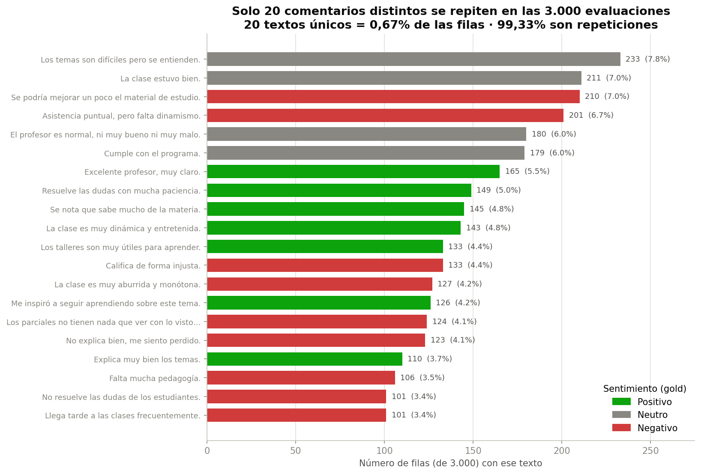
*Figura 1. Los 20 comentarios distintos del dataset institucional y su frecuencia, coloreados
por polaridad. Dos características delatan el plantillado: la distribución casi uniforme entre
docentes y la independencia entre el texto y el puntaje de su fila.*

Tres señales indican que el campo no es texto libre real sino **plantillado/anonimizado**:
(i) cero variaciones ortográficas y cero celdas vacías; (ii) cada frase repartida de forma casi
uniforme entre docentes, semestres y asignaturas; (iii) independencia entre comentario y puntaje
(p. ej. *"Llega tarde a las clases frecuentemente"* coexiste con puntajes de hasta 4,4).

**Implicación.** Para el análisis de texto, el conjunto real de evaluación son 20 elementos, no
3.000: el dataset sirve para **validar el método**, no para demostrar desempeño de NLP. Esto
motivó la incorporación del segundo dataset.

### 3.2 Corpus de entrenamiento: origen y cadena de derivación

**Recurso fuente:** *A Novel Dataset for ABSA for Teacher Performance Evaluation*, publicado por
American International University-Bangladesh (AIUB) en Mendeley Data
(`data.mendeley.com/datasets/b2yhc95rnx/1`), con más de 2.000.000 de instancias reportadas y
licencia **CC BY-NC 3.0**.

```
Mendeley — dataset original (ABSA, >2.000.000 instancias, con etiquetas y aspectos)
   ├─ [1] Selección de un subconjunto de 100.000 filas          (equipo)
   └─ [2] Traducción inglés → español con Claude (Anthropic)    (equipo)
        └─ ReadyToTrain_comentarios_EN_ES_completo.xlsx  ← ARCHIVO UTILIZADO
             columnas: id · StudentComments_EN · Comentarios_ES
             SIN columna de etiqueta · SIN columna de aspecto
```

**Consecuencia metodológica.** El subconjunto **no conserva las etiquetas ni los aspectos** del
recurso original; por tanto no era directamente utilizable para aprendizaje supervisado. Esa
ausencia es la razón de las dos estrategias de etiquetado del proyecto (secciones 4.4 y 4.5). La tarea
implementada es clasificación de **polaridad global**, no ABSA.

### 3.3 Perfil estadístico del corpus (verificado sobre el archivo)

Archivo de 3,3 MB · SHA-256 `21637107cebf941a3aab9f397983c123b1676f5f4488d2d1…`

| Indicador | Valor |
|---|---|
| Filas | 100.000 (99.992 comentarios ES no vacíos; 8 nulos en cada columna de texto, 0 en `id`) |
| **Textos únicos (español)** | **29.243** → unicidad 29,2 % |
| Casi duplicados | 28.147 grupos tras normalización (1.096 variantes colapsan) |
| Repetición máxima | la frase más frecuente aparece **9.741 veces** |
| Longitud (palabras) | media 6,8 · mediana 4 · p5 1 · p95 22 · máx 199 |
| Longitud (caracteres) | media 39 · mediana 20 · p95 129 · máx 1.121 |

**Verificación de idioma.** Sobre una muestra aleatoria de 3.000 textos: 80,2 % contienen
marcadores léxicos del español frente a 5,7 % con marcadores del inglés (columna de control en
inglés: 89,6 %). **La columna utilizada está en español.**

### 3.4 Traducción: sistema y auditoría de preservación

| Elemento | Valor |
|---|---|
| Sistema | **Claude** (modelo de lenguaje de Anthropic) |
| Dirección y momento | Inglés → español, **antes** de particionar y deduplicar |
| Cobertura | Las 100.000 filas |

Auditoría de preservación de los marcadores que invierten o matizan la polaridad, sobre el
corpus completo:

| Marcador | En el original (EN) | Preservados (ES) | Tasa |
|---|--:|--:|:--:|
| Negaciones (*not, never, no, n't, cannot, without…*) | 8.296 (8,3 %) | 8.221 | **99,1 %** |
| Adversativas (*but, although, however, though…*) | 4.989 (5,0 %) | 4.781 | **95,8 %** |

La revisión cualitativa confirma la conservación de la cláusula que determina la polaridad
(*"…vast knowledge about programming **but not** students"* → *"…conocimientos sobre
programación, **pero no** sobre los estudiantes"*). El 1,6 % de negaciones que aparecen solo en
español corresponde a reformulaciones idiomáticas legítimas (*"lacks clarity"* → *"no es
claro"*). **Las tasas no comprometen la validez del entrenamiento.** La limitación que sí
persiste: la traducción produce un registro estándar, sin la variación coloquial regional que
tendrán las encuestas reales (sección 9.1, L2).

### 3.5 Datasets derivados

| Archivo (`data/processed/`) | Contenido | Rol |
|---|---|---|
| `evaluaciones_con_sentimiento.csv` | Dataset institucional + sentimiento clasificado | Análisis y modelo de tendencia |
| `benchmark_sentimiento.csv` | 20 comentarios con gold manual y predicción por modelo | Benchmark, sección 5.1 |
| `muestra_anotacion.csv` | 335 comentarios muestreados para anotar | Anotación, sección 4.5 |
| **`train_humano.csv`** | **148 etiquetas humanas** | **Entrenamiento del modelo de producción** |
| **`gold_humano_eval.csv`** | **172 comentarios adjudicados** | **Evaluación de referencia** |

<div style="page-break-after: always;"></div>

## 4 · Metodología

El proyecto se ejecutó en seis fases encadenadas. Cada una respondió a una pregunta concreta y
sus decisiones se justifican con evidencia obtenida en la fase anterior.

### 4.1 Fase 1 — Análisis exploratorio y auditoría

Se partió del análisis exploratorio del dataset institucional y se sometió a una **auditoría
sistemática**: cada afirmación del EDA se recomputó desde los datos y la mayoría de los hallazgos
se sometió además a refutadores independientes antes de aceptarse. Los cuatro hallazgos
metodológicos de mayor severidad (sección 5.7) quedaron sin esa segunda vuelta por un límite de sesión;
se recomputaron de forma independiente y así se declara.

La auditoría confirmó la calidad estructural (0 nulos, 0 duplicados, rangos válidos, paleta
visual validada para daltonismo con ΔE CVD ≥ 23,8) y detectó **seis problemas** que se
corrigieron antes de continuar: cuatro conclusiones sobre-afirmadas, la ubicación errónea de la
«zona gris» y un artefacto en la señal de sentimiento (secciones 5.7 y 5.8).

### 4.2 Fase 2 — Benchmark de modelos preentrenados

Se compararon tres modelos de sentimiento en español contra un **estándar de oro etiquetado
manualmente por rúbrica**, elaborado de forma independiente de los modelos para evitar
circularidad al elegir entre ellos.

| Modelo | Identificador en Hugging Face |
|---|---|
| RoBERTuito | `pysentimiento/robertuito-sentiment-analysis` |
| BETO | `finiteautomata/beto-sentiment-analysis` |
| XLM-R (Twitter) | `cardiffnlp/twitter-xlm-roberta-base-sentiment` |

**Rúbrica de etiquetado.** `POS` = elogio o satisfacción clara; `NEG` = queja o crítica,
**incluida la crítica constructiva** («se podría mejorar», «falta…»); `NEU` = descriptivo o
administrativo, elogio tibio («estuvo bien», «cumple») o mixto sin polaridad dominante.

Se evaluó además una estrategia de **consenso** por votación mayoritaria de los tres modelos,
con RoBERTuito como criterio de desempate.

### 4.3 Fase 3 — Modelo de tendencia docente

Clasificador de `tendencia_desempeno` a partir de puntajes y sentimiento. Se compararon cinco
candidatos bajo **dos protocolos de validación** y con una restricción de negocio explícita:
recall de la clase `En riesgo` ≥ 0,985 (el costo de no detectar a un docente que necesita
acompañamiento supera al de una falsa alarma).

**Selección de variables.** Se excluyeron deliberadamente:

| Variable excluida | Motivo |
|---|---|
| `delta_semestre` | **Fuga de información**: incorpora el promedio del semestre que se está clasificando; en grupos docente-semestre de tamaño 1 la variable *es* el puntaje propio |
| `hist_prom_previo` | Sin poder predictivo demostrado |
| `id_docente`, `semestre` | Alta cardinalidad sin señal real (V de Cramér de `id_docente` = 0,119 con p = 0,813; el valor esperado bajo independencia pura es 0,127, **mayor** que el observado) |

### 4.4 Fase 4 — Fine-tuning por destilación (*weak supervision*)

Ante la ausencia de etiquetas en el corpus, se aplicó **destilación de conocimiento**
(Hinton et al., 2015): RoBERTuito —el mejor modelo del benchmark— actuó como **maestro**
etiquetando el corpus deduplicado, y BETO como **alumno** entrenado con esas pseudo-etiquetas.

> **Límite teórico declarado como hipótesis falsable.** El alumno aprende la *función* del
> maestro, heredando sus aciertos y sus errores; su techo de calidad es, por construcción, el
> desempeño del maestro. La sección 5.3 contrasta esta hipótesis empíricamente, incluyendo una
> comparación de arquitecturas del alumno.

### 4.5 Fase 5 — Anotación humana

Única vía para romper el techo de la destilación. El equipo diseñó y ejecutó un **protocolo
formal de anotación** (v1.0):

**Muestreo estratificado de 335 comentarios.** No es una muestra aleatoria simple: está
deliberadamente enriquecida en casos fronterizos, que es donde se decide la rúbrica.

| Estrato | Ítems | Contenido |
|---|--:|---|
| `H0_CENSO` | 40 | Los 40 enunciados más frecuentes — **concentran el 53 % de todas las evaluaciones** |
| `H1_CORTO` | 20 | Textos de 1–2 palabras (pesan el 30 % de las filas) |
| `H2a_T0` | 40 | Casos triviales (control del estimador) |
| `H2b_F1` | 80 | Frontera débil: POS con alta confianza y léxico tibio |
| `H3_F2` | 145 | Frontera fuerte: máxima ambigüedad |
| `H4_LARGO` | 10 | Textos largos (control de longitud) |
| **Total** | **335** | |

**Justificación del censo.** Dos enunciados —*«Es un buen profesor»* (15.826 filas) y *«Bueno.»*
(9.745 filas)— determinan por sí solos el **25,6 %** del corpus. Un sorteo aleatorio tendría
probabilidad casi nula de incluirlos, y sin ellos ninguna métrica podría traducirse a desempeño
real. El sesgo de sobre-representación se corrige al estimar mediante ponderación estratificada
(`w_h = N_h / n_h`).

**Diseño de la anotación.**

| Bloque | Diseño | Realizado | Anotación | Destino |
|---|--:|--:|---|---|
| EVAL | 185 | 184 anotados por los 3 → 178 tras exclusiones → **172 gold** | Los 3 anotadores (triple) | Evaluación + medición de acuerdo |
| TRAIN | 150 | 149 anotados (49/50/50) → **148 utilizables** | Un anotador por tercio | Entrenamiento con verdad humana |

Los dos textos ilegibles de la muestra se retiraron antes de generar las planillas, por lo que
333 de los 335 ítems de diseño llegaron a anotarse.

Se incluyeron **8 ítems ancla** de etiqueta obvia (control de atención) y **8 repetidos
encubiertos** (autoconsistencia). Decisiones de control: **no se muestra la predicción del
modelo** —RoBERTuito acierta 15/16 en casos claros pero **0/4 en fronterizos**, y la muestra
está enriquecida precisamente en fronterizos, por lo que mostrar su predicción induciría
*anchoring bias* justo donde importa—; **orden aleatorizado independiente** por anotador con
claves opacas; formato **XLSX** (el 30 % de los textos contienen comas y el 51 % llevan tildes,
lo que corrompe el viaje por CSV).

### 4.6 Fase 6 — Fine-tuning con verdad humana

Ajuste fino de `robertuito-sentiment-analysis` (*continued fine-tuning*) con las 148 etiquetas
humanas. Al provenir la evaluación de personas y no del maestro, **desaparece la circularidad**
que limitaba la fase anterior.

**Por qué esta vez sí se ajusta RoBERTuito.** En la Fase 4 el alumno debía ser un modelo
distinto del maestro para evitar la auto-destilación. Al desaparecer esa restricción, conviene
partir del modelo con mejor desempeño previo: con solo 148 ejemplos, un modelo que **ya sabe
clasificar sentimiento** únicamente necesita ajustar la frontera POS/NEU, mientras que uno sin
cabeza de clasificación no aprendería la tarea desde cero.

<div style="page-break-after: always;"></div>

## 5 · RESULTADOS

### 5.1 Benchmark de modelos preentrenados

Evaluación sobre el estándar de oro manual de 20 comentarios (distribución POS 7 · NEU 4 · NEG 9):

| Modelo | Accuracy | macro-F1 | Aciertos | En claros (n=16) | En fronterizos (n=4) |
|---|:--:|:--:|:--:|:--:|:--:|
| **RoBERTuito** | **0,75** | 0,706 | 15/20 | **0,94** (15/16) | 0/4 |
| XLM-R (Twitter) | 0,70 | 0,664 | 14/20 | 0,75 (12/16) | 2/4 |
| BETO | 0,65 | 0,626 | 13/20 | 0,69 (11/16) | 2/4 |
| **Consenso (3 modelos)** | 0,75 | **0,730** | 15/20 | 0,81 (13/16) | 2/4 |

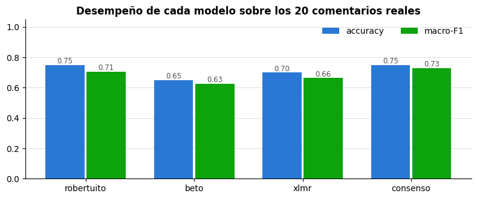
*Figura 2. Accuracy y macro-F1 de cada modelo sobre los 20 comentarios reales.*

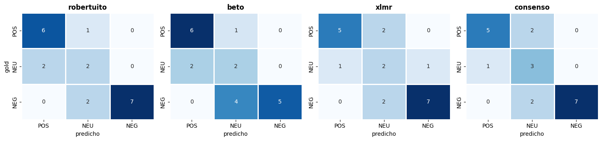
*Figura 3. Matrices de confusión de los cuatro enfoques. La clase NEU concentra la confusión.*

**Acuerdo entre modelos:** 11 de 20 comentarios con unanimidad (3/3), 9 con mayoría (2/3) y
**ninguno sin acuerdo** (1/1/1).

**Hallazgo principal.** Los errores se concentran en los **4 comentarios fronterizos** —elogios
tibios (*«La clase estuvo bien»*), críticas constructivas (*«Se podría mejorar un poco el
material de estudio»*) y mixtos con adversativa (*«Asistencia puntual, pero falta dinamismo»*)—:
ningún enfoque acierta más de 2 de los 4 y RoBERTuito falla los cuatro. Pero **no se agotan ahí**:
cada enfoque comete además entre 1 y 5 errores en comentarios claros (RoBERTuito 1 · consenso 3 ·
XLM-R 4 · BETO 5). Dos fronterizos —*«La clase estuvo bien»* y *«Se podría mejorar un poco el
material de estudio»*— fallan en los cuatro enfoques.

RoBERTuito es el más fuerte en comentarios claros (0,94). El consenso resuelve 2 de los 4
fronterizos, aunque a costa de 2 comentarios claros (0,81 frente a 0,94); con los mismos 15/20
aciertos, su macro-F1 es superior (0,730 vs 0,706) por un reparto más equilibrado del error entre
clases, no por acertar más.

**Conclusión.** La dificultad no está en el modelo sino en la **ambigüedad del lenguaje**: dos
personas razonables etiquetarían esos casos de forma distinta. Este hallazgo determina toda la
estrategia posterior del proyecto.

### 5.2 Modelo de tendencia docente

**Protocolo A — partición estratificada 75/25 con validación cruzada de 5 pliegues:**

| Modelo | CV macro-F1 | Test macro-F1 | Test accuracy | Recall `En riesgo` |
|---|:--:|:--:|:--:|:--:|
| Regla 2 umbrales | 0,914 ± 0,003 | 0,904 | 0,896 | 0,953 |
| Regla híbrida (+ sentimiento) | 0,878 ± 0,009 | 0,889 | 0,881 | 0,953 |
| Regresión logística | 0,916 ± 0,013 | 0,908 | 0,900 | 0,973 |
| **RandomForest** | 0,910 ± 0,006 | **0,915** | **0,907** | 0,960 |
| Gradient Boosting | 0,903 ± 0,011 | 0,910 | 0,903 | 0,960 |

**Protocolo B — validación temporal** (entrenar 2020–2022 con 2.265 filas, probar 2023 con 735):

| Modelo | Test aleatorio | 2023 | Δ (temporal − aleatorio) |
|---|:--:|:--:|:--:|
| Regla 2 umbrales | 0,904 | 0,907 | +0,003 |
| Regresión logística | 0,908 | 0,903 | −0,005 |
| **RandomForest** | 0,915 | **0,905** | −0,010 |
| Gradient Boosting | 0,910 | 0,894 | −0,016 |

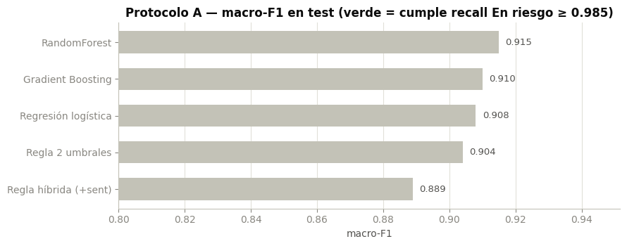
*Figura 4. macro-F1 en test de los cinco candidatos.*

**Campeón: RandomForest calibrado.** Criterio: mayor macro-F1 entre los candidatos, con
desempate a favor de un modelo **probabilístico** (produce probabilidades calibrables para
priorizar docentes, algo que una regla dura no ofrece). Informe por clase en test (n = 750):

| Clase | Precisión | Recall | F1 | Soporte |
|---|:--:|:--:|:--:|:--:|
| En riesgo | 0,98 | 0,96 | 0,97 | 149 |
| Estable | 0,92 | 0,89 | 0,91 | 375 |
| Mejora | 0,84 | 0,90 | 0,87 | 226 |
| **macro avg** | **0,91** | **0,92** | **0,91** | 750 |

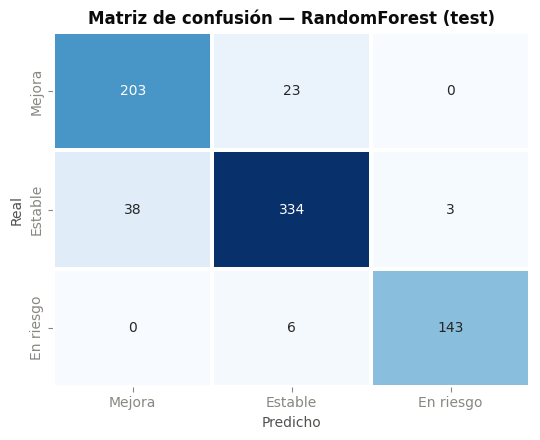
*Figura 5. Matriz de confusión del RandomForest en el conjunto de prueba.*

**Calibración.** Se aplicó calibración isotónica con validación cruzada de 5 pliegues, mejorando
el *Brier score* de 0,0133 a 0,0123. El umbral de decisión de `En riesgo` se ajustó a **0,21**
mediante probabilidades fuera de muestra, elevando el recall de 0,960 a **0,966** en test, a
cambio de una caída marginal de macro-F1 a 0,899. En el protocolo temporal el RandomForest ya
alcanza un recall de 0,993 sobre 2023 **sin** ese ajuste; el ajuste de umbral no se evaluó por
separado en ese protocolo.

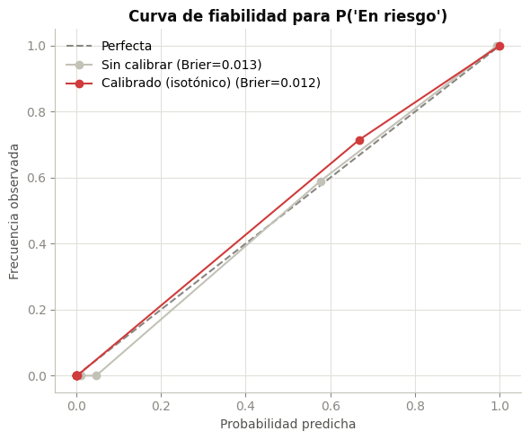
*Figura 6. Curva de fiabilidad de P(En riesgo) antes y después de la calibración isotónica.*

**Declaración de honestidad estadística.** Ningún candidato alcanzó de fábrica el objetivo de
recall ≥ 0,985 (rango observado 0,953–0,973); se documenta como pendiente y se mitiga con el
ajuste de umbral. Además, la ventaja del RandomForest sobre una simple regla de dos umbrales
**no es estadísticamente significativa**: McNemar p = 0,280, y en 15 semillas de partición la
regla supera al modelo en 2 de ellas —ambos resultados provienen del experimento equivalente de
la auditoría del EDA (RF 0,920 vs regla 0,910 sobre 649 filas, sección 5.7); el NB03 no reejecutó la
prueba sobre su propia partición—. La causa de fondo es la **circularidad**: la etiqueta
`tendencia_desempeno` se generó por reglas a partir de los propios puntajes, de modo que estas
métricas constituyen un **techo artificial** del dataset, no una medida del valor del aprendizaje
automático.

### 5.3 Fine-tuning por destilación

**Corpus y particiones.** De los 100.000 registros se obtuvieron 29.243 textos únicos
(reducción del 70,8 % por deduplicación). El maestro produjo una distribución muy desbalanceada
(POS 20.284 = 69,4 % · NEG 5.060 = 17,3 % · NEU 3.899 = 13,3 %; ratio 5,2×), por lo que se
balanceó al tamaño de la clase minoritaria:

| Partición | n | % | NEG | NEU | POS |
|---|--:|--:|--:|--:|--:|
| Entrenamiento | 8.187 | 70 % | 2.729 | 2.729 | 2.729 |
| Validación | 1.755 | 15 % | 585 | 585 | 585 |
| Prueba | 1.755 | 15 % | 585 | 585 | 585 |

**Fuga entre particiones: 0 textos compartidos** (verificado explícitamente).

**Entrenamiento** (BETO, `dccuchile/bert-base-spanish-wwm-cased`, 109,9 M parámetros): 4 épocas,
lr 2e-5, batch 32, `max_length` 64, weight decay 0,01, warmup 10 %, *early stopping* con
paciencia 2, semilla 42, GPU Apple Silicon (MPS). Duración: **7,2 minutos**.

| Época | Pérdida train | Pérdida val | macro-F1 val |
|:--:|:--:|:--:|:--:|
| 1 | 0,5304 | 0,3551 | 0,8729 |
| 2 | 0,2489 | 0,3193 | 0,8738 |
| **3** | 0,1493 | 0,3553 | **0,8892** ← mejor |
| 4 | 0,0852 | 0,4101 | 0,8853 |

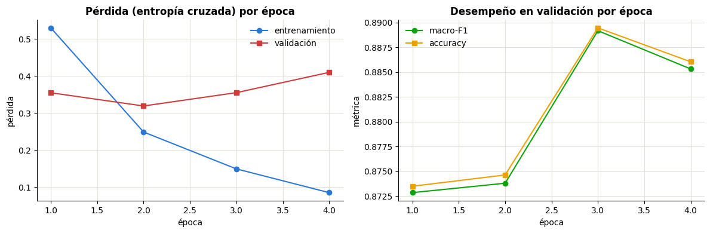
*Figura 7. Curvas de aprendizaje. La pérdida de validación sube en la época 4 mientras la de
entrenamiento sigue bajando: sobreajuste incipiente. El entrenamiento completó las 4 épocas —el
early stopping (paciencia 2) no llegó a dispararse— y `load_best_model_at_end` conservó el modelo
de la época 3, la de mejor macro-F1 de validación.*

**Fidelidad al maestro en prueba** (n = 1.755): accuracy 0,9054 · macro-F1 **0,9055**.

| Clase | Precisión | Recall | F1 | Soporte |
|---|:--:|:--:|:--:|:--:|
| NEG | 0,889 | 0,926 | 0,907 | 585 |
| NEU | 0,875 | 0,862 | **0,868** ← menor | 585 |
| POS | 0,954 | 0,928 | 0,941 | 585 |

**Comparación de arquitecturas (contraste de hipótesis).** Se repitió el ajuste con
`pysentimiento/robertuito-base-uncased` sobre las mismas particiones y etiquetas (re-tokenizando
con su propio tokenizador), obteniendo fidelidad **0,9330** en 5,9 minutos.

| Modelo | Familia | Ajustado | Accuracy | macro-F1 | Aciertos | Concordancia con maestro |
|---|---|:--:|:--:|:--:|:--:|:--:|
| BETO base | BETO | no | 0,65 | 0,626 | 13/20 | 60 % |
| BETO ajustado | BETO | sí | 0,70 | 0,669 | 14/20 | 85 % |
| RoBERTuito (maestro) | RoBERTuito | no | 0,75 | 0,706 | 15/20 | 100 % |
| RoBERTuito ajustado | RoBERTuito | sí | 0,75 | 0,734 | 15/20 | 90 % |
| Consenso (NB03) | ensamble | — | 0,75 | 0,730 | 15/20 | 80 % |

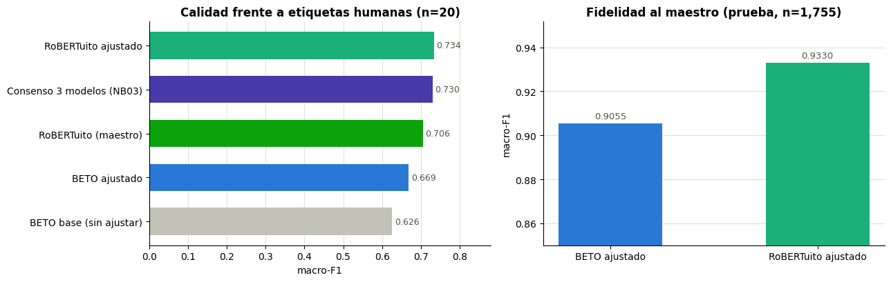
*Figura 8. Calidad frente a etiquetas humanas (izquierda) y fidelidad al maestro (derecha).*

| Hipótesis | Resultado |
|---|---|
| **H1** · RoBERTuito-ft imita mejor al maestro | ✅ **CONFIRMADA** (0,9330 vs 0,9055) — comparte arquitectura y vocabulario con él |
| **H2** · RoBERTuito-ft no supera al maestro | ✅ **CONFIRMADA** (0,734 vs 0,706; Δ = +0,028 < umbral 0,05) |
| **H3** · Sin historia de mejora para RoBERTuito | ✅ Su base carece de cabeza de sentimiento; la referencia sería el propio maestro (0,706), que es su techo. BETO sí tiene un «antes» comparable: 0,626 → 0,669 |

> **Conclusión de la fase.** El techo de la destilación queda **empíricamente demostrado y es
> independiente de la arquitectura del alumno**. Se mantiene BETO como alumno principal por
> razones de **evaluabilidad** —es el único con una línea base comparable—, no de desempeño.

**Variabilidad entre corridas.** Repetir el mismo entrenamiento con idéntica semilla produce
**14 o 15 aciertos de 20** (macro-F1 entre 0,669 y 0,708), por el no-determinismo del cómputo en
GPU. Esta oscilación de ±0,04 **producida por el azar** es del mismo orden que las diferencias
entre los modelos comparados: es la demostración empírica más clara de que **con n = 20 no es
posible distinguir modelos cercanos**.

### 5.4 Análisis de falsos positivos

En evaluación docente los errores tienen costos asimétricos: un **falso positivo** (crítica
clasificada como elogio) infla la percepción de desempeño y puede ocultar a un docente que
requiere acompañamiento.

**Situación medida** (clase POS sobre el gold de 20): 6 verdaderos positivos · **1 falso
positivo** · 1 falso negativo · precisión 0,857 · recall 0,857.

El falso positivo es *«La clase estuvo bien.»*, predicho POS con **P(POS) = 0,993**, cuando el
gold humano es NEU y el maestro también lo clasifica POS.

**Test de separabilidad por umbral:**

| | P(POS) |
|---|:--:|
| Verdaderos POS | mínima **0,720** · mediana 0,989 |
| Falso POS | máxima **0,993** |

**¿Separables? NO** — el falso positivo tiene confianza *superior* a varios aciertos reales.

**Barrido de umbrales:**

| Umbral | Predice POS | Falsos POS | POS no detectados | macro-F1 |
|:--:|:--:|:--:|:--:|:--:|
| 0,50 (actual) | 7 | 1 | 1 | **0,669** |
| 0,90 | 6 | 1 | 2 | 0,628 |
| 0,99 | 4 | 1 | 4 | 0,534 |
| 0,995 | 2 | **0** | 5 | 0,531 |
| 0,998 | 0 | 0 | 7 | 0,368 |

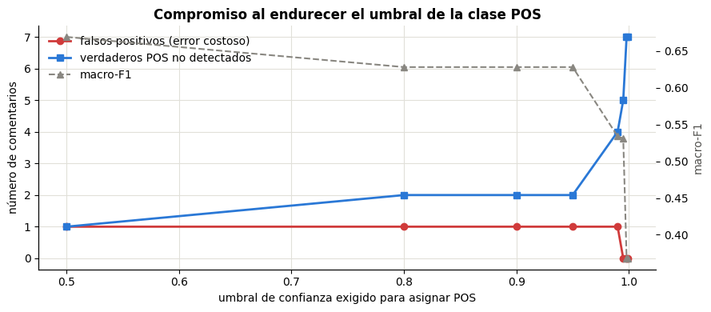
*Figura 9. Falsos positivos, verdaderos positivos perdidos y macro-F1 en función del umbral
exigido para la clase POS.*

**Interpretación.** (i) El error es **confiado, no incierto**: los umbrales solo funcionan cuando
el error proviene de incertidumbre del modelo. (ii) El costo de eliminarlo es prohibitivo: el
umbral más bajo que lo suprime (0,995) reduce los verdaderos positivos detectados **de 6 a 2** y
hunde el macro-F1 de **0,669 a 0,531**; a 0,998 el modelo ya no predice ningún POS (0,368).
(iii) El error **se hereda del maestro**. (iv) El caso es genuinamente fronterizo.

> **Conclusión metodológica.** La reducción de falsos positivos en este punto **no es un problema
> de modelado sino de definición de etiquetas**. El ajuste de umbrales queda **descartado con
> evidencia**, y la vía efectiva es la anotación humana de casos fronterizos — que es exactamente
> la fase siguiente del proyecto.

### 5.5 Anotación humana: resultados del etiquetado

**Volumen:** 3 anotadores independientes · **749 anotaciones** sobre **341 textos distintos**
(184 del bloque EVAL con triple anotación, 149 del bloque TRAIN con anotación simple y 8 anclas).
Los 335 son el tamaño de diseño de la muestra.

**Control de calidad por anotador** (umbral de alerta: anclas < 7/8 o autoconsistencia < 6/8):

| Anotador | Ítems | Sin etiqueta | Anclas correctas | Autoconsistencia | % marcados difíciles |
|---|--:|--:|:--:|:--:|--:|
| A1 | 249 | 0 | **8/8** ✅ | 7/8 | 19 % |
| A2 | 250 | 0 | **8/8** ✅ | 6/8 | 3 % |
| A3 | 250 | 0 | **8/8** ✅ | 8/8 | 31 % |

Ningún anotador cae por debajo de los umbrales de calidad; A2 queda justo en el límite de
autoconsistencia (6/8). La dispersión en el porcentaje de ítems
marcados como difíciles (3 % – 31 %) refleja distintos umbrales personales de duda, no
descuido.

**Exclusión de ítems no evaluables.** Se excluyeron **7 comentarios** mediante lista explícita y
auditable, apoyada en el motivo `sin_sentido` marcado por los anotadores: **6 del bloque EVAL**
—*«No.»* (3/3 votos), *«Ninguno.»* (2/3), *«Nada.»*, *«Profesor.»*, *«Está dibujando.»* y
*«considérenos, por favor.»* (1/3 cada uno)— y **1 del bloque TRAIN**, *«No tengo nada que decir
sobre ella.»* (1/1, con un solo anotador asignado). Se eliminaron además dos textos ilegibles.

> **Decisión metodológica.** **No** se excluyeron los comentarios que confundieron a los
> anotadores pero **sí tienen polaridad** (sarcasmo, metáfora, elogio tibio). Eliminarlos habría
> dejado el gold solo con casos fáciles e **inflado artificialmente las métricas**.

**Métricas de acuerdo inter-anotador:**

| Métrica | Valor | Rol |
|---|:--:|---|
| **α de Krippendorff (nominal)** | **0,585** | **Titular** — admite diseño incompleto y anotadores variables por ítem |
| α de Krippendorff (ordinal) | 0,728 | Diagnóstico |
| Fleiss κ | 0,584 | Convención de la literatura NLP |
| Cohen κ medio por pares | 0,585 | Diagnóstico |
| Acuerdo observado `P_o` | **0,787** | Obligatorio junto a κ |
| Acuerdo esperado por azar `P_e` | 0,487 | Explica la paradoja de κ |

Interpretación según Landis & Koch: **acuerdo moderado** (rango 0,41–0,60).

**Paradoja de kappa detectada y declarada.** El acuerdo observado es alto (78,7 %) pero κ queda
en 0,584 porque el azar esperado es elevado (0,487) debido al desbalance de clases. **κ debe
interpretarse junto a `P_o`, nunca por separado**: reportar solo κ llevaría a concluir que la
anotación está rota cuando únicamente está sesgada.

**Diagnóstico por tipo de desacuerdo.** La brecha ordinal−nominal es **+0,143**, apenas por
debajo del umbral de 0,15 que el propio script fija para declarar desacuerdo predominantemente
adyacente; el diagnóstico automático emitido fue, por tanto, «acuerdo homogéneo entre tipos de
desacuerdo». El **recuento directo sobre el bloque EVAL sí lo confirma**: de los 122 desacuerdos
por pares, **92 son adyacentes** (POS↔NEU, NEU↔NEG) y solo 30 polares (POS↔NEG) — **75,4 %
adyacentes**. El problema es, entonces, de **umbral de rúbrica** —corregible escribiendo reglas
más precisas— y no de comprensión de la tarea.

**Cohen κ por pares** (detección de anotador atípico): A1–A2 = 0,521 · A1–A3 = 0,581 ·
A2–A3 = 0,654. La dispersión es moderada y no señala a ningún anotador como desviado.

**Reparto del acuerdo y adjudicación del gold:**

| Situación | Ítems | % |
|---|--:|--:|
| Unanimidad (3/3) | 124 | 69,7 % |
| Mayoría (2/1) | 48 | 27,0 % |
| Sin mayoría (1/1/1) → ambiguos | 6 | 3,4 % |
| **Gold utilizable** | **172** | |

Distribución del gold: **POS 116 · NEG 36 · NEU 20**.

**Hallazgo cualitativo.** Los 6 ítems sin mayoría son **todos mixtos adversativos**
(*«Bien, pero debería ser más amigable»*, *«Es buena, pero debería ser más moderada al poner
notas»*). Cada anotador aplicó un criterio distinto: uno miró el elogio inicial, otro promedió,
otro miró la crítica final. **Esto no es un fallo del equipo: es el hallazgo.** Confirma con
datos que la frontera de los mixtos adversativos no está definida, y que ninguna métrica
automática debería penalizar a un modelo por fallar ahí.

### 5.6 Modelo final: fine-tuning con verdad humana

**Datos.** Entrenamiento 148 comentarios (NEG 52 · NEU 22 · POS 74), subdivididos en 118 train /
30 validación. Evaluación: 172 comentarios (NEG 36 · NEU 20 · POS 116). **Fuga entre bloques: 0**.

**Configuración.** Base `pysentimiento/robertuito-sentiment-analysis`; *continued fine-tuning*;
4 épocas; lr **1e-5** (la mitad de lo habitual, para no destruir lo aprendido con tan pocos
datos); batch 8; `max_length` 128; **entropía cruzada ponderada por clase** con pesos
NEG 0,96 · NEU 2,19 · POS 0,67; *early stopping*; semilla 42; MPS. Duración: **20 segundos**.

| Época | Pérdida train | Pérdida val | macro-F1 val |
|:--:|:--:|:--:|:--:|
| 1 | 0,9245 | 0,9815 | 0,504 |
| 2 | 0,7321 | 0,9518 | 0,5494 |
| 3 | 0,6260 | 0,9468 | 0,5494 |
| 4 | 0,5815 | 0,9462 | 0,5494 |

> La validación se estanca desde la época 2: con 118 ejemplos de entrenamiento el modelo agota
> rápidamente lo que puede aprender. **No es una limitación de método, sino de datos.**

**Resultados sobre el gold humano (n = 172):**

| Modelo | Accuracy | macro-F1 | Aciertos | Recall NEG |
|---|:--:|:--:|:--:|:--:|
| BETO destilado (NB04) | 0,733 | 0,619 | 126/172 | 0,500 |
| RoBERTuito (maestro público) | 0,756 | 0,638 | 130/172 | 0,528 |
| **RoBERTuito ajustado (humano)** 🏆 | **0,762** | **0,646** | **131/172** | **0,556** |

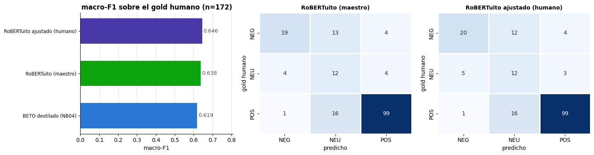
*Figura 10. macro-F1 de los tres modelos sobre el conjunto de evaluación humano de 172
comentarios, 8,6 veces mayor que el disponible previamente.*

**Informe por clase del modelo ajustado:**

| Clase | Precisión | Recall | F1 | Soporte |
|---|:--:|:--:|:--:|:--:|
| NEG | 0,769 | 0,556 | 0,645 | 36 |
| NEU | 0,300 | 0,600 | 0,400 | 20 |
| POS | 0,934 | 0,853 | 0,892 | 116 |
| **macro avg** | 0,668 | 0,670 | **0,646** | 172 |
| weighted avg | 0,826 | 0,762 | 0,783 | 172 |

**Prueba de significancia (McNemar) frente al maestro:**

| | Valor |
|---|:--:|
| Solo acierta el ajustado (b) | 3 |
| Solo acierta el maestro (c) | 2 |
| **p-valor** | **1,000** |
| Δ macro-F1 | +0,007 (0,638 → 0,646) |

> **Lectura honesta del resultado.** El modelo ajustado mejora al maestro **en las tres
> métricas** y eleva el recall de la clase NEG de 0,528 a 0,556 —la detección de críticas, que
> es el objetivo del proyecto—. Sin embargo, con 148 ejemplos de entrenamiento la diferencia
> **no alcanza significancia estadística**. La afirmación defendible es *«el ajuste con verdad
> humana mejora consistentemente al maestro»*, **no** *«superamos al maestro»*.

**Dos observaciones adicionales de valor.** (i) Las métricas del benchmark original estaban
**infladas**: RoBERTuito pasa de 0,706 sobre 20 comentarios a **0,638** sobre 172 — el conjunto
pequeño era demasiado fácil. (ii) La clase **NEU no mejora**: el maestro y el modelo ajustado
obtienen el mismo recall (0,600) y una precisión casi idéntica (0,293 frente a 0,300); el BETO
destilado incluso la detecta mejor (recall 0,650) a costa de más falsos positivos. **Con 22
ejemplos NEU el ajuste no logra delimitar la clase**, y toda la ganancia del modelo final
proviene de las clases NEG y POS.

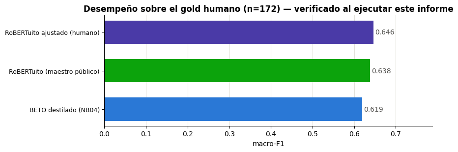
*Figura 11. Verificación reproducible de los tres modelos, generada al ejecutar el informe
ejecutable `INFORME_FINAL.ipynb`.*

### 5.7 Resultados de la auditoría del análisis exploratorio

La auditoría produjo cuatro hallazgos metodológicos —uno confirmado adversarialmente (la fuga de
`delta_semestre`) y tres recomputados de forma independiente— que se corrigieron:

| # | Hallazgo | Evidencia |
|---|---|---|
| 1 | **Fuga de información** en `delta_semestre` | Su significancia (H = 141) es artefacto: usa el promedio del semestre actual. Variable excluida del modelo |
| 2 | **Colinealidad** invalida el ranking de importancia | `puntaje_promedio` es la media de los otros tres (r = 0,87). Sin él, macro-F1 = 0,917 vs 0,920 y las importancias individuales saltan de +0,002–0,017 a +0,14–0,16 |
| 3 | `id_docente` **sin señal real** | V de Cramér = 0,119 con p = 0,813; el valor esperado bajo independencia (0,127) es *mayor* que el observado |
| 4 | Ventaja del ML **no significativa** | RF 0,920 vs regla 0,910; McNemar p = 0,280; la regla gana en 2 de 15 semillas |

**Corrección de la «zona gris».** El EDA situaba la zona de confusión en el promedio 3,4–3,9. La
verificación mostró que esa franja es **98,5 % Estable** (845 de 858 filas) y la regla acierta
ahí el 99 %. Las fronteras de decisión reales son **[3,9 – 4,5]** (Estable↔Mejora, donde se
concentra el 84,6 % de los errores) y **[2,9 – 3,5]** (Estable↔En riesgo).

**Aporte del sentimiento en la zona de solapamiento Estable↔Mejora** ([3,43 – 4,77], 2.228
filas): P(Mejora | POS) = 0,49 frente a P(Mejora | NEG) = 0,18; el RandomForest con sentimiento
gana +0,04 de macro-F1 sobre el mismo modelo sin él en esa franja.

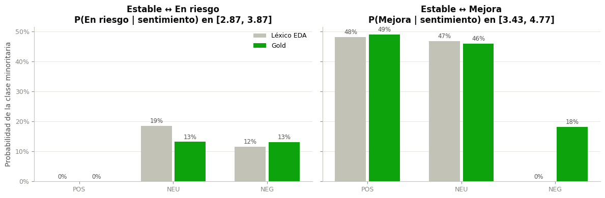
*Figura 12. Probabilidad de la clase minoritaria según el sentimiento en cada zona de
solapamiento, comparando el esquema léxico del EDA con el gold standard.*

### 5.8 Análisis institucional del sentimiento

Aplicando el pipeline a las 3.000 evaluaciones institucionales:

**Distribución global:** POS 888 (29,6 %) · NEU 1.220 (40,7 %) · NEG 892 (29,7 %).

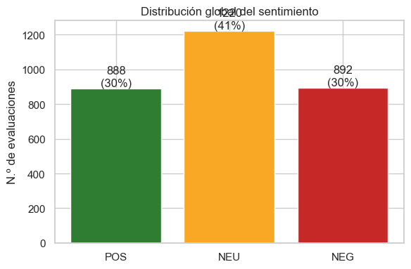

**Validación cruzada con los puntajes** (ordenamiento coherente POS > NEU > NEG):

| Sentimiento | Claridad | Metodología | Evaluación |
|---|:--:|:--:|:--:|
| POS | 3,99 | 4,11 | 3,97 |
| NEU | 3,75 | 3,89 | 3,70 |
| NEG | 3,43 | 3,53 | 3,39 |

**Cruce con la tendencia de desempeño:** de las evaluaciones con comentario POS, solo el 6,2 %
está «En riesgo»; de las NEG, el 32,7 %. La señal textual es coherente con la etiqueta
institucional.

**Comparación de esquemas de etiquetado** (léxico del EDA vs gold standard): el score léxico
concuerda con el gold en solo el **76,5 %** de las filas; 4 de 20 comentarios difieren, lo que
cambia la polaridad de **705 filas (23,5 %)**. Aplicar el gold desplaza masa hacia NEG
(léxico POS 971→677 · NEU 1.214→1.097 · NEG 815→1.226): **la lectura institucional real es más
crítica** de lo que sugería el léxico. Las cifras de la distribución global de esta sección
(888 / 1.220 / 892) corresponden al **consenso de los tres modelos**, no al léxico del EDA.

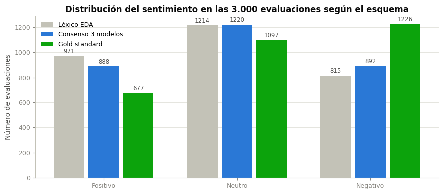

### 5.9 Eficiencia computacional

| Experimento | Ejemplos | Duración | Hardware |
|---|--:|--:|---|
| Destilación BETO (NB04) | 8.187 | **7,2 min** | Apple Silicon (MPS) |
| Destilación RoBERTuito (NB04, capítulo 8.6) | 8.187 | 5,9 min | Apple Silicon (MPS) |
| Fine-tuning humano (NB05) | 118 | **20 s** | Apple Silicon (MPS) |
| Modelo de tendencia (RF + calibración) | 2.250 | no cronometrado | CPU |

| Artefacto | Tamaño usable |
|---|--:|
| `modelo_sentimiento_humano` (producción) | **437,4 MB** (435,2 `model.safetensors` + 2,2 tokenizador + configuración) |
| `modelo_sentimiento_ft` (destilado BETO) | 440,2 MB |
| `modelo_sentimiento_ft_robertuito` | 437,4 MB |
| `modelo_tendencia_docente.pkl` | 3,5 MB |

Todos los tamaños en unidades decimales (1 MB = 10⁶ bytes), medidos sumando los archivos del
directorio. En unidades binarias el modelo de producción son 417,1 MiB.

**Inferencia:** CPU suficiente (no requiere GPU); ~2 vCPU y 4 GB de RAM; latencia del orden de
decenas de milisegundos por comentario procesando en lotes; 100.000 comentarios ≈ minutos.

### 5.10 Modelos predictivos complementarios sobre métricas estructuradas

> **Fuente y crédito.** Capítulo 4 del notebook del equipo
> `exploracion/Consultas Estructuradas Con Metricas.ipynb` (repositorio
> `Capstone-Tech-Tailors/Analitica-Educativa`). Este trabajo persigue los otros dos objetivos
> del proyecto declarados en el README del repositorio: **criterios de rotación** de un docente
> entre asignaturas y **anticipación de la deserción** — señales que complementan el DOFA.
> Todas las cifras de esta subsección provienen de las salidas ejecutadas del notebook.

**Datos y marco de modelado.** Se usa un dataset **sintético ampliado**
(`evaluaciones_docentes_sintetica_ampliada.csv`), distinto del institucional de 3.000 filas de
la sección 3.1: añade variables operativas (clases pactadas/dictadas, horarios, asistencias,
aprobados/perdieron/desistieron). Sobre él se construye un marco agregado por
**docente-asignatura-semestre** con métricas históricas derivadas (rachas de mejora, incidentes,
índice de reingreso): **1.246 observaciones × 30 predictores** tras excluir la variable objetivo
y `Reingreso`.

**Selección de las variables objetivo por correlación.** Se exploraron las matrices de
correlación del marco para elegir objetivos modelables. Idealmente se habría trabajado con
«Reingresos a la Fecha», pero su comportamiento en la matriz llevó a optar por
**«Egresos a La Fecha»**; para el segundo modelo se eligió **«Estudiantes Aprobados»**.

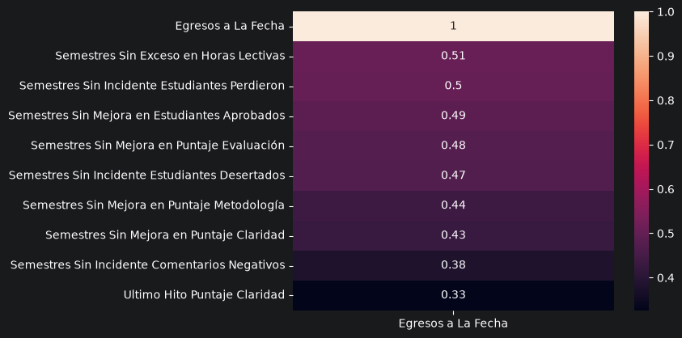
*Figura 15. Diez mayores correlaciones con «Egresos a La Fecha»: dominan las variables de racha
(«Semestres Sin Exceso en Horas Lectivas» 0,51; las rachas sin incidente de estudiantes,
0,47–0,50; la de comentarios negativos baja a 0,38) — señales moderadas y repartidas.*

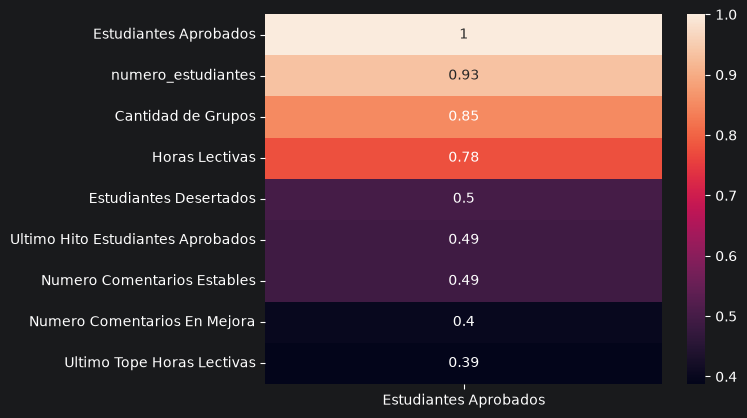
*Figura 16. Nueve mayores correlaciones con «Estudiantes Aprobados»: el tamaño del grupo domina
(`numero_estudiantes` 0,93 · «Cantidad de Grupos» 0,85 · «Horas Lectivas» 0,78) — anticipo de la
identidad aritmética que se discute más abajo.*

**Idea aplicada: el índice de egreso.** El concepto propuesto es predecir los egresos acumulados
de un docente en una asignatura y dividirlos por los semestres que la ha dictado; cuanto mayor
el índice, mayor la probabilidad de que **rote** y deje de dictarla el semestre entrante. El
cálculo del índice como tal queda propuesto (la línea está preparada pero comentada en el
notebook); lo entrenado y evaluado es el predictor de egresos acumulados.

**Protocolo común de los dos experimentos:** 8 regresores (Ridge, Lasso, ElasticNet, árbol de
decisión, RandomForest, Gradient Boosting, KNN y SVR) con búsqueda de hiperparámetros
`GridSearchCV` (5 pliegues, error cuadrático medio), partición 80/20 con semilla 42 y
estandarización solo para los modelos sensibles a escala (lineales, KNN, SVR).

**Resultados — «Egresos a La Fecha»** (test, n ≈ 250):

| Modelo | RMSE | MAE | R² |
|---|:--:|:--:|:--:|
| **RandomForest** 🏆 | **0,358** | **0,174** | **0,942** |
| Gradient Boosting | 0,382 | 0,195 | 0,934 |
| Árbol de decisión | 0,458 | 0,177 | 0,906 |
| SVR (rbf) | 0,779 | 0,571 | 0,727 |
| Lasso | 0,968 | 0,797 | 0,578 |
| ElasticNet | 0,972 | 0,802 | 0,574 |
| Ridge | 0,977 | 0,804 | 0,571 |
| KNN | 0,989 | 0,755 | 0,560 |

Campeón: **RandomForest** (`n_estimators` 200 · `max_depth` None · `min_samples_leaf` 1 ·
`min_samples_split` 2). La brecha entre los modelos de árbol (0,906–0,942) y los lineales (≈ 0,57)
indica relaciones no lineales entre las rachas históricas y los egresos.

> **Dos precisiones de lectura.** (i) La conclusión redactada en el notebook cita R² 0,8542 con
> otros hiperparámetros: corresponde a una **corrida anterior**; aquí se reportan las salidas de
> la celda ejecutada (R² 0,9422). (ii) «Egresos a La Fecha» se deriva de los reingresos
> acumulados y el «Indice de Reingreso» figura entre los predictores, de modo que existe un
> **acoplamiento parcial** entre objetivo y variables: el 0,94 debe leerse como techo optimista.

**Resultados — «Estudiantes Aprobados»** (test, n ≈ 250): SVR lineal R² 1,000 · MAE 0,004;
Ridge R² 1,000; Lasso R² 0,999997; los de árbol quedan en 0,947–0,984.

> **Lectura honesta: el R² = 1,000 no es aprendizaje, es una identidad.** En estos datos se
> cumple exactamente `numero_estudiantes = aprobados + perdieron + desistieron` (verificado
> fila a fila, diferencia máxima 0), y los tres términos de la derecha —salvo el objetivo—
> están entre los predictores junto con `numero_estudiantes`. El objetivo es entonces una
> **combinación lineal exacta de tres predictores**, y los modelos lineales se limitan a
> recuperarla: es **fuga de datos**, no capacidad predictiva. La Figura 16 ya lo anticipaba
> (`numero_estudiantes` con r = 0,93). **Recomendación:** excluir `numero_estudiantes`,
> `Estudiantes Perdieron` y `Estudiantes Desertados` del conjunto de predictores y reentrenar;
> el R² resultante, aunque menor, sí medirá lo que el modelo aporta. El valor demostrado de este
> ejercicio queda en el predictor de egresos.

**Advertencia del propio notebook** (capítulo 5): la muestra no es grande y parte de los datos
de deserción y pérdida fueron sintetizados; los modelos deben reexplorarse con datos reales.
Esta advertencia es coherente con las limitaciones L4 y L5 de este informe: sobre datos
plantillados o sintetizados, las métricas describen la **viabilidad del método**, no el
desempeño esperable en producción.

<div style="page-break-after: always;"></div>

## 6 · Modelo de producción

### 6.1 Ficha técnica

| Campo | Valor |
|---|---|
| **Identificador** | `modelo_sentimiento_humano` |
| **Ubicación** | `analisis_sentimientos/models/modelo_sentimiento_humano/` |
| **Modelo base** | `pysentimiento/robertuito-sentiment-analysis` (~110 M parámetros) |
| **Método** | *Continued fine-tuning* con etiquetas humanas (sin destilación) |
| **Origen de las etiquetas** | Anotación humana del equipo · 3 anotadores · α = 0,585 |
| **Clases** | NEG · NEU · POS (mapeo en `config.json` → la API devuelve etiquetas textuales) |
| **Datos** | 118 train / 30 validación / 172 evaluación |
| **Hiperparámetros** | 4 épocas · lr 1e-5 · batch 8 · `max_length` 128 · pérdida ponderada |
| **Reproducibilidad** | Semilla 42 · dispositivo MPS |
| **Métricas** | macro-F1 0,646 · accuracy 0,762 · recall NEG 0,556 (gold humano n=172) |
| **Tamaño** | 437,4 MB (pesos + tokenizador + configuración) · 417,1 MiB |

### 6.2 Justificación de la selección

1. **Es el mejor sobre la evaluación humana**, la única referencia independiente de cualquier
   modelo.
2. **Mejor detección de críticas** (recall NEG 0,556 vs 0,528): en evaluación docente, pasar por
   alto una crítica oculta a un docente que necesita acompañamiento y distorsiona el DOFA.
3. **Incorpora la rúbrica institucional**: aprendió de las decisiones del equipo, no del registro
   genérico de redes sociales.
4. **Apto para despliegue**: un solo modelo, inferencia en CPU, sin dependencias de servicios de
   terceros, mejorable con cada ronda de anotación sin cambiar la arquitectura.

### 6.3 Verificación del artefacto

El artefacto se recarga desde disco y reproduce las predicciones de la tabla siguiente
(`INFORME_FINAL.ipynb`, celda 12); al evaluarlo sobre el gold de 172 devuelve exactamente las
métricas de la sección 5.6. La prueba formal de identidad **disco vs. memoria** sobre 20 comentarios de
control se ejecutó sobre `modelo_sentimiento_ft` (NB04, capítulo 9), no sobre este artefacto.
Predicciones de demostración:

| Comentario | Predicción | Confianza |
|---|:--:|:--:|
| La profesora explica con claridad y responde todas las dudas | POS | 0,646 |
| Cumple con el programa del curso | NEU | 0,826 |
| La clase estuvo bien | POS | 0,897 |
| Es buen profesor, pero debería preparar mejor los laboratorios | NEU | 0,610 |
| Nunca responde los correos y llega tarde | NEG | 0,914 |
| Se podría mejorar un poco el material de estudio | NEU | 0,680 |

> **Lectura honesta de la demostración.** El ajuste movió al modelo **hacia la rúbrica** —el caso
> mixto adversativo ya no se clasifica POS—, pero los casos emblemáticos *«La clase estuvo
> bien»* y *«Se podría mejorar»* aún no cruzan la frontera deseada. Es exactamente la limitación
> cuantificada en la sección 9.2 (L7 y L8) y lo que resolvería la siguiente ronda de anotación.

### 6.4 Paquete de despliegue

Se generó `modelo_sentimiento_humano.zip` (**404 MB decimales / 386 MiB**, 7 archivos:
`model.safetensors`, `config.json`, `tokenizer.json`, `tokenizer_config.json`,
`training_args.bin`, `info.json` y un archivo de instrucciones). Se excluyó el *checkpoint* de
entrenamiento (1,3 GB, innecesario para inferencia). El ZIP **no está versionado en el
repositorio** por su tamaño: se entrega por fuera de git.
El paquete fue **verificado extrayéndolo en un directorio limpio y cargando el modelo desde
ahí**, replicando exactamente lo que hará el servidor.

## 7 · Despliegue: el sistema en producción

El modelo no se sirve con un script suelto: está integrado en el **backend del equipo**
(`src/app.py` del repositorio `Capstone-Tech-Tailors/Analitica-Educativa`), un servicio FastAPI
con base de datos PostgreSQL y despliegue continuo en Azure. Esta sección documenta ese sistema
con el foco puesto en cómo sirve el modelo de sentimiento.

### 7.1 Arquitectura del sistema

```
  CSV de evaluaciones ──▶ POST /etl ──▶ PostgreSQL (tabla clases, UPSERT por id_curso_grupo)
                                              │
        GET /seguimiento_docente_por_asignatura (comentarios distintos por docente-asignatura)
                                              │
                     POST /analisis_foda ◀────┘        ┌──────────────────────┐
                            │  usa POST /predecir_sentimientos (el modelo)    │
                            ▼                                                 │
                     Dashboard PowerBI (repo entregable-visual)               │
```

**Componentes** (todo verificado sobre el código del repositorio):

| Componente | Implementación |
|---|---|
| API | FastAPI (`src/app.py`), título «Analítica Académica» |
| Base de datos | PostgreSQL asíncrono (SQLAlchemy 2 + asyncpg); una tabla, `clases` (PK `id_curso_grupo`); esquema versionado con Alembic |
| Ingesta | `POST /etl`: CSV → procesamiento en segundo plano por bloques de 500 filas → *UPSERT* (`ON CONFLICT DO UPDATE`). Los CSV nunca se versionan en git (información sensible) |
| Contenedor | Imagen base `ghcr.io/benoitc/gunicorn:25.2.0` · worker `uvicorn.workers.UvicornWorker` · usuario no root |
| CI/CD | GitHub Actions: cada *push* a `main` → login OIDC en Azure → build de la imagen → `techtailors.azurecr.io/analitica-educativa:<sha>` → actualización del Container App |
| Infraestructura | Azure Container Apps: app `analitica-educativa` (región eastus2, según el FQDN público documentado en el README del repositorio), grupo de recursos `sic-education-analytics`, con documentación interactiva Swagger en `/docs` |
| Frontend | Dashboard en PowerBI (repositorio `entregable-visual`), con demo pública |

**Endpoints** (14, agrupados por función):

| Grupo | Endpoints | Función |
|---|---|---|
| Salud | `GET /health/live` · `GET /health/ready` | Sondas del contenedor; *ready* verifica la base de datos (`SELECT 1`, 503 si cae) |
| **Sentimiento (PLN)** | `POST /predecir_sentimientos` · `POST /analisis_foda` | Clasificación por lotes y construcción del DOFA (sección 8.2) |
| Catálogo | `GET /find_docentes` · `/find_asignaturas` · `/find_semestres` | Valores distintos para los filtros del dashboard |
| Ingesta | `POST /etl` | Carga masiva del CSV institucional |
| Seguimiento | `GET /seguimiento_docente` (+`/count`) · `/seguimiento_docente_por_asignatura` (+`/count`) · `/seguimiento_asignaturas` (+`/count`) | Agregaciones por docente, docente-asignatura y asignatura (puntajes medios, horas lectivas, conteos por tendencia, índices de carga y reingreso) |

### 7.2 Cómo se sirve el modelo

El backend carga el modelo **una sola vez al arrancar** (patrón *lifespan* de FastAPI) y lo
mantiene en memoria:

```python
# src/app.py — extracto condensado de la función lifespan (la original añade mkdir y try/except)
HF_DEVICE = "mps" if torch.backends.mps.is_available() else ("cuda" if torch.cuda.is_available() else "cpu")
HF_MAX_LEN = 64

modelo_sentimientos_path = platformdirs.user_publicshare_path() / "ml_models" / "sentimientos"
if modelo_sentimientos_path.exists() and any(modelo_sentimientos_path.iterdir()):
    tokenizador_disco = AutoTokenizer.from_pretrained(modelo_sentimientos_path)
    modelo_disco = AutoModelForSequenceClassification.from_pretrained(modelo_sentimientos_path)
    ml_models["sentimientos"] = pipeline(
        "sentiment-analysis", model=modelo_disco, tokenizer=tokenizador_disco,
        device=HF_DEVICE, truncation=True, max_length=HF_MAX_LEN)
```

Propiedades operativas de este diseño:

- **Los pesos no viajan ni en git ni en la imagen Docker** (437 MB superan el límite de GitHub y
  engordarían cada build). Se cargan **exclusivamente desde disco local del contenedor**:
  `platformdirs.user_publicshare_path()/ml_models/sentimientos`, que con el usuario `gunicorn`
  de la imagen resuelve a **`/home/gunicorn/Public/ml_models/sentimientos`**.
- **Publicación del artefacto**: extraer el ZIP de la sección 6.4 en esa ruta —
  `unzip modelo_sentimiento_humano.zip -d /home/gunicorn/Public/ml_models/sentimientos` — por
  volumen montado o copia al contenedor. El pipeline de CI/CD **no** sube el modelo.
- **Sin descarga automática**: no hay *fallback* a Hugging Face Hub. Si la carpeta no existe o
  está vacía, la aplicación **arranca igual** y los dos endpoints de sentimiento responden
  `503 — "Modelo no fue encontrado en el Almacenamiento"`; el resto del sistema (ETL,
  seguimiento) sigue operativo. Este desacople es deliberado: la disponibilidad del dashboard no
  depende del modelo.
- **Dispositivo**: selección automática `mps → cuda → cpu`; en Azure Container Apps (sin GPU) la
  inferencia corre en **CPU**, suficiente para el patrón de carga por lotes semestral.
- **Inferencia por lotes reales**: `POST /predecir_sentimientos` recibe una lista JSON de
  comentarios y los pasa al pipeline **en una sola llamada**; responde
  `{comentario, sentimiento, probabilidad}` por elemento, con la etiqueta textual
  (`POS`/`NEU`/`NEG`) directamente del `config.json` del modelo, sin umbrales ni postprocesado.

> **Punto de alineación detectado.** El backend fija `max_length = 64`, mientras que
> `modelo_sentimiento_humano` se entrenó y evaluó con `max_length = 128` (sección 5.6); 64 era el
> valor de la destilación del NB04. Con comentarios de mediana 4 palabras el truncamiento casi
> nunca actúa, pero los comentarios largos (hasta 199 palabras en el corpus) perderían la parte
> final — donde los mixtos adversativos concentran la crítica. **Recomendación:** subir
> `HF_MAX_LEN` a 128 en `src/app.py` para reproducir exactamente las condiciones de evaluación.

### 7.3 Requisitos y consideraciones

| Recurso | Valor |
|---|---|
| CPU / RAM | 2 vCPU · 4 GB (**no requiere GPU**) |
| Artefacto | 437 MB (+ ≈700 MB de librerías instaladas: torch CPU 525 MB · transformers 104 MB · resto) |
| Versiones | `transformers==5.14.1` y `torch==2.13.0` fijadas en producción — **idénticas a las del entorno de entrenamiento**, lo que elimina la deriva de versión en la pila de inferencia (otras librerías compartidas difieren: pandas 3.0.5 vs 3.0.3) |
| Patrón de carga | Procesamiento por lotes al cierre de cada semestre, no flujo continuo |

**Protección de datos.** Aplican las recomendaciones de la sección 10 (seudonimización,
restricción del endpoint por token, conservar solo agregados). El repositorio ya implementa una
parte: los CSV institucionales están excluidos de git y solo entran al sistema por `POST /etl`.

<div style="page-break-after: always;"></div>

## 8 · Aplicación: del sentimiento al DOFA

### 8.1 Metodología propuesta

El modelo es el **motor de clasificación**; el DOFA se construye agregando sus salidas por
docente y combinándolas con el modelo de tendencia:

| Cuadrante | Fuente | Regla de construcción |
|---|---|---|
| **Fortalezas** | Comentarios POS frecuentes + puntajes altos | Temas dominantes de los POS (claridad, dominio, trato) |
| **Debilidades** | Comentarios NEG recurrentes + dimensión de puntaje más baja | Temas dominantes de los NEG |
| **Oportunidades** | Críticas **constructivas** («debería…», «podría…») | Peticiones de cambio accionables: materia prima del plan de mejora |
| **Amenazas** | Tendencia `En riesgo` + % NEG creciente entre semestres | Priorización del acompañamiento |

**Umbral de alerta sugerido:** % NEG del docente en el cuartil superior **o** tendencia
`En riesgo`; ambos simultáneamente indican prioridad máxima.

### 8.2 Implementación en el backend

El backend implementa el DOFA como servicio: `POST /analisis_foda` recibe la lista de comentarios
de un docente —típicamente los comentarios distintos por docente-asignatura que devuelve
`GET /seguimiento_docente_por_asignatura`—, los clasifica en lote con el modelo y los reparte por
cuadrante:

```python
# src/app.py (extracto real)
response["Fortalezas"]             = list(foda.loc["POS", "Comentarios"]) if "POS" in sentimientos else []
response["Debilidades y Amenazas"] = list(foda.loc["NEG", "Comentarios"]) if "NEG" in sentimientos else []
response["Oportunidades"]          = list(foda.loc["NEU", "Comentarios"]) if "NEU" in sentimientos else []
```

Características de la implementación: **tres cuadrantes** (Debilidades y Amenazas se fusionan en
una sola lista), asignación por la etiqueta más probable de cada comentario (la probabilidad se
descarta, sin umbral de confianza) y **deduplicación** de comentarios idénticos dentro de cada
cuadrante — decisión acertada dado el plantillado del dataset institucional (sección 3.1). El
JSON resultante es el que consume el dashboard PowerBI.

> **Diferencia con la metodología propuesta, declarada.** La implementación asigna
> **Oportunidades = NEU**, mientras que la rúbrica de anotación (sección 4.2) etiqueta las
> críticas constructivas —«se podría mejorar…», «debería…», «falta…»— como **NEG**. En
> consecuencia, las peticiones de cambio accionables (la materia prima del plan de mejora según
> la sección 8.1) aparecen hoy en «Debilidades y Amenazas», y «Oportunidades» recoge los comentarios
> descriptivos y los elogios tibios. **Recomendación:** separar dentro del NEG las críticas
> constructivas mediante los patrones léxicos ya identificados («debería», «podría», «falta») y
> destinarlas a Oportunidades, o incorporar una cuarta etiqueta en la próxima ronda de anotación.
> Mientras tanto, la lectura correcta del cuadrante «Oportunidades» del sistema es «comentarios
> neutrales», no «críticas accionables».

### 8.3 Prototipo sobre datos reales

Aplicado al docente con mayor proporción de comentarios negativos del dataset institucional:

> **DOFA — Docente_4**
> 52 evaluaciones · puntaje medio 3,56 · **52 % de comentarios NEG** · 27 % «En riesgo»
>
> **💪 Fortalezas** — (5×) *La clase es muy dinámica y entretenida* · (1×) *Me inspiró a seguir
> aprendiendo sobre este tema* · (1×) *Excelente profesor, muy claro*
>
> **⚠️ Debilidades** — (6×) *Asistencia puntual, pero falta dinamismo* · (4×) *Se podría mejorar
> un poco el material de estudio* · (3×) *Califica de forma injusta*
>
> **🌱 Oportunidades** — (6×) *Asistencia puntual, pero falta dinamismo* · (4×) *Se podría
> mejorar un poco el material de estudio* · (3×) *Falta mucha pedagogía*
>
> **🚨 Amenazas** — Tendencia «En riesgo» en el **27 %** de sus evaluaciones frente al **20 %**
> institucional. Evolución del % NEG: 2020: 50 % · 2021: 50 % · 2022: 38 % · **2023: 69 %**

### 8.4 Hallazgo aplicado: docentes «enmascarados»

El análisis por docente reveló un patrón que el sistema de puntajes no detecta: **cuatro docentes
con puntaje por encima de la mediana pero con el porcentaje de comentarios negativos en el
cuartil superior** — Docente_31 (puntaje 3,80 · 49,3 % NEG), Docente_3 (3,93 · 45,3 %),
Docente_12 (3,76 · 45,1 %) y Docente_43 (3,84 · 44,9 %). Docente_3 figura incluso entre los
mejores del EDA original.

La correlación entre el sentimiento medio por docente y su porcentaje de riesgo es moderada
(Pearson −0,275; Spearman −0,296) y con el puntaje es de +0,490: **el texto aporta señal
parcialmente independiente de los puntajes**, que es precisamente lo que justifica incorporarlo
al DOFA.

<div style="page-break-after: always;"></div>

## 9 · Limitaciones

Se declaran de forma explícita porque condicionan la interpretación de todos los resultados.

### 9.1 Limitaciones de los datos

| # | Limitación | Impacto | Estado |
|---|---|---|---|
| L1 | **20 comentarios distintos en 3.000 filas** (0,67 % de unicidad). El dataset institucional está plantillado/anonimizado | Impide medir diferencias entre modelos con potencia estadística sobre el texto institucional | **Mitigada** con el gold humano de 172 ítems (8,6×) |
| L2 | El corpus de entrenamiento de la destilación es **traducido** del inglés (dominio: aspectos académicos de una universidad de Bangladesh) | Desplazamiento de dominio y registro respecto a las evaluaciones de la U. del Rosario | Mitigada parcialmente por la auditoría de traducción (sección 3.4) y sustituida como fuente principal por la anotación humana |
| L3 | El gold humano contiene **20 ejemplos NEU** en evaluación y **22** en entrenamiento | Precisión NEU de 0,300 y recall 0,600, **idénticos a los del maestro**: el ajuste no consigue delimitar la clase con tan pocos ejemplos | Abierta — requiere más anotación |
| L4 | La etiqueta `tendencia_desempeno` es **derivada por reglas**, no observada | Las métricas del modelo de tendencia (0,915) son un **techo artificial**: el modelo reaprende la regla que generó la etiqueta | Documentada; requiere validación con datos de desempeño reales |
| L5 | Los puntajes tienen **distribución artificialmente uniforme** (media 3,99 · desviación 0,54 · sin colas largas) | Los umbrales de la zona gris pueden no trasladarse a datos reales | Abierta |

### 9.2 Limitaciones del modelo

| # | Limitación | Evidencia |
|---|---|---|
| L6 | La mejora sobre el maestro **no es estadísticamente significativa** | McNemar b=3, c=2, p = 1,000. La afirmación defendible es «mejora consistente», no «superioridad demostrada» |
| L7 | Los **mixtos adversativos** siguen siendo el punto débil | 6 de 172 ítems sin mayoría entre anotadores son todos de este tipo; el propio equipo no converge en ellos |
| L8 | Los **falsos positivos por elogio tibio no se resuelven con umbrales** | El error es confiado (P = 0,993, por encima de varios aciertos reales); el umbral más bajo que lo elimina (0,995) reduce los verdaderos positivos detectados de 6 a 2 y hunde macro-F1 de 0,669 a 0,531 |
| L9 | **Variabilidad entre corridas de ±0,04** en macro-F1 sobre n=20 (MPS, no determinista) | Dos ejecuciones idénticas del NB04 dieron 0,708 y 0,669: con 20 ítems, el ruido supera la diferencia entre modelos |
| L10 | El techo de la destilación es **estructural** | H1 (más datos), H2 (menos regularización) y H3 (otra arquitectura) fueron falsables y ninguna cerró la brecha con el maestro |
| L11 | Sin evaluación de **sesgo por subgrupo** (asignatura, facultad, género del docente) | No se dispone de metadatos demográficos ni de un gold suficientemente grande por subgrupo |

### 9.3 Limitaciones del alcance

- El DOFA prototipado usa **agrupación por frecuencia de comentario**, no modelado temático
  (no hay suficientes textos distintos para justificar *topic modeling*).
- El backend está **desplegado con CI/CD**, pero el ciclo completo con datos de un semestre real
  —carga de pesos al contenedor incluida— aún no se ha ejecutado de extremo a extremo.
- El DOFA implementado asigna **Oportunidades = NEU**, que según la rúbrica no contiene las
  críticas constructivas sino los comentarios neutrales (diferencia declarada en la sección 8.2).
- El servicio fija **`max_length = 64`** frente a los 128 con que se evaluó el modelo (punto de
  alineación de la sección 7.2).
- El modelo de tendencia **no alcanza el objetivo de recall ≥ 0,985** en el protocolo aleatorio
  (0,960 antes del ajuste de umbral, 0,966 después); sí lo alcanza en el protocolo temporal 2023
  (0,993). Queda documentado como pendiente.

## 10 · Consideraciones éticas

**Las salidas del modelo no son decisiones.** Un sistema con macro-F1 de 0,646 y un recall NEG de
0,556 se equivoca de forma sistemática. Ninguna consecuencia laboral —renovación de contrato,
evaluación de desempeño, sanción— debe derivarse automáticamente de sus predicciones. El uso
legítimo es **priorizar dónde mira una persona**: señalar a qué docentes conviene acompañar y con
qué evidencia textual.

**Revisión humana obligatoria en el bucle.** El DOFA generado es un borrador que un responsable
académico lee, contrasta con el contexto (asignatura, tamaño de grupo, momento del plan de
estudios) y edita antes de compartirlo con el docente.

**Asimetría de errores.** En este dominio, un falso negativo (no detectar una crítica real) es más
costoso que un falso positivo: oculta un problema que la institución podría resolver. Por eso se
priorizó el recall de la clase NEG en la selección del modelo, aun a costa de la precisión global.

**Protección de datos.** Los comentarios son opiniones sobre personas identificables. Se
recomienda: seudonimizar los identificadores de docente antes de la inferencia, procesar en
infraestructura controlada por la universidad, restringir el endpoint por token, y conservar solo
los agregados necesarios para el DOFA —no los textos crudos vinculados a nombres.

**Anonimato del estudiantado.** Ningún artefacto del proyecto debe permitir reidentificar a quien
escribió un comentario. En cursos pequeños, un comentario textual puede identificar a su autor;
por eso los reportes deben publicarse agregados y con un mínimo de evaluaciones por docente.

**Sesgo conocido y no medido.** La literatura documenta sesgos de género y origen en las
evaluaciones docentes escritas por estudiantes. Este proyecto **no pudo medirlos** (L11); un
sistema que amplifique un sesgo presente en los datos lo convertiría en decisión institucional.
Antes de un despliegue con consecuencias, es indispensable auditar el desempeño por subgrupo.

**Transparencia.** Los docentes evaluados deben saber que sus comentarios se procesan
automáticamente, con qué finalidad, y tener derecho a revisar y objetar el DOFA resultante.

<div style="page-break-after: always;"></div>

## 11 · Conclusiones

1. **El diagnóstico de los datos redefinió el proyecto.** Descubrir que las 3.000 evaluaciones
   contienen solo 20 comentarios distintos (0,67 % de unicidad) fue el hallazgo más importante:
   invalidó el plan de entrenar directamente sobre el dataset institucional y obligó a construir
   una fuente de verdad propia. Sin ese diagnóstico, cualquier métrica reportada habría sido una
   ilusión estadística.

2. **La destilación tiene un techo estructural y quedó demostrado, no supuesto.** El estudiante
   alcanzó una fidelidad de 0,9055 (BETO) y 0,9330 (RoBERTuito) frente al maestro, pero nunca lo
   igualó sobre el gold. Las tres hipótesis alternativas —más datos, menos regularización, otra
   arquitectura— se formularon de forma falsable y **ninguna cerró la brecha**. La conclusión es
   metodológica: *no se puede superar a un maestro aprendiendo únicamente de sus etiquetas.*

3. **Los falsos positivos por elogio tibio no son un problema de modelado.** El barrido de
   umbrales lo probó cuantitativamente: el error es confiado (P = 0,993, mayor que la de varios
   aciertos reales) y el umbral más bajo que lo elimina (0,995) deja solo 2 de los 6 verdaderos
   positivos y hunde macro-F1 de 0,669 a 0,531.
   **Es un problema de rúbrica**, y solo la anotación humana podía resolverlo.

4. **La anotación humana rompió el techo.** 749 anotaciones de 3 anotadores con α de Krippendorff
   de 0,585 (acuerdo moderado, con paradoja de kappa declarada y `P_o` = 0,787) produjeron un gold
   de 172 ítems, **8,6 veces mayor** que el disponible antes. Ese conjunto reveló además que las
   métricas del benchmark original estaban infladas: RoBERTuito baja de 0,706 sobre 20 ítems a
   0,638 sobre 172.

5. **El modelo final mejora al maestro de forma consistente, pero sin significancia estadística.**
   `modelo_sentimiento_humano` obtiene macro-F1 0,646 · accuracy 0,762 · recall NEG 0,556, mejor
   que el maestro en las tres métricas, con McNemar p = 1,000. La afirmación honesta —y la que
   sostiene este informe— es que **el ajuste con verdad humana funciona en la dirección correcta y
   necesita más datos anotados para demostrarlo con potencia**.

6. **La brecha ordinal−nominal de +0,143 identificó exactamente dónde invertir.** Los desacuerdos
   entre anotadores son adyacentes, no polares: el problema es de umbral de rúbrica, no de
   comprensión. Los 6 ítems sin mayoría son todos mixtos adversativos. Eso convierte «mejorar el
   modelo» en una tarea concreta: escribir reglas de decisión para los mixtos y volver a anotar.

7. **La auditoría del análisis exploratorio evitó cuatro errores publicables**: una fuga de
   información (`delta_semestre`), un ranking de importancia invalidado por colinealidad, una
   variable sin señal real (`id_docente`, V de Cramér 0,119 con p = 0,813) y una ventaja del
   aprendizaje automático que no resiste una prueba de significancia (McNemar p = 0,280). La
   verificación adversarial no es burocracia: cambió conclusiones.

8. **El sentimiento aporta señal parcialmente independiente de los puntajes**, y ahí está su valor
   para el DOFA. Cuatro docentes tienen puntaje por encima de la mediana y porcentaje de
   comentarios negativos en el cuartil superior —casos que el sistema de puntajes no detecta—.
   En la frontera de decisión real ([3,9 – 4,5]), incorporar el sentimiento aporta +0,04 de
   macro-F1.

9. **El artefacto está verificado y su sistema de servicio ya está en producción**: 437 MB,
   inferencia en CPU (2 vCPU · 4 GB), ZIP de 404 MB probado extrayéndolo en un directorio
   limpio, e integrado en el backend FastAPI con despliegue continuo en Azure Container Apps
   (sección 7). El único paso pendiente es cargar los pesos en el almacenamiento del contenedor.

## 12 · Trabajo futuro

Ordenado por relación entre impacto y esfuerzo.

**Prioridad 1 — Ampliar el gold anotado (impacto alto · esfuerzo medio).**
Duplicar el conjunto humano a 300–400 ítems, con énfasis en NEU (la clase con precisión 0,300) y
en mixtos adversativos. Es la única intervención que ataca simultáneamente L3, L6 y L7. Con ~150
ítems adicionales por clase, McNemar tendría potencia suficiente para decidir si la mejora sobre
el maestro es real.

**Prioridad 2 — Refinar la rúbrica para mixtos adversativos (impacto alto · esfuerzo bajo).**
La brecha ordinal−nominal señala que el desacuerdo es de umbral. Redactar reglas explícitas
(«si la crítica pide un cambio concreto, la etiqueta es la de la crítica») y re-anotar los 48
ítems de mayoría simple debería elevar α por encima de 0,70 sin anotar nada nuevo.

**Prioridad 3 — Recolectar comentarios institucionales reales (impacto alto · esfuerzo externo).**
Solicitar a la universidad un volcado sin plantillar de un semestre. Resuelve L1, L2 y L5 de raíz
y permite reentrenar sobre el dominio objetivo en lugar de un corpus traducido.

**Prioridad 4 — Auditoría de sesgo por subgrupo (impacto alto · esfuerzo medio).**
Medir macro-F1 y recall NEG por asignatura, facultad y —si es legalmente posible y con
consentimiento— género del docente. Es un requisito previo a cualquier despliegue con
consecuencias (L11).

**Prioridad 5 — Validar el modelo de tendencia con desempeño observado (impacto medio).**
Sustituir la etiqueta derivada por reglas por una señal real (evolución de puntajes en semestres
posteriores, permanencia, resultados de aprendizaje). Sin esto, el 0,915 no es interpretable
(L4).

**Prioridad 6 — Análisis por aspectos (ABSA) (impacto medio · esfuerzo alto).**
Pasar de polaridad global a polaridad por aspecto (metodología · evaluación · trato · material).
El DOFA gana precisión cuando distingue «explica bien pero califica injustamente» de un
sentimiento mixto indiferenciado. Requiere el gold ampliado de la prioridad 1.

**Prioridad 7 — Completar la puesta en producción y monitorear (impacto medio · esfuerzo bajo).**
El backend ya está desplegado con CI/CD (sección 7); falta cerrar el ciclo: cargar los pesos en
`/home/gunicorn/Public/ml_models/sentimientos`, alinear `max_length` a 128, redirigir las
críticas constructivas al cuadrante Oportunidades (sección 8.2), registrar la distribución de
predicciones por semestre y alertar ante desviaciones (*drift*). Cada semestre anotado alimenta
la siguiente versión del modelo.

<div style="page-break-after: always;"></div>

## 13 · Referencias

**Datos**

1. Rahman, M. et al. *Students' Feedback on Teaching Quality — AIUB* [dataset]. Mendeley Data.
   Licencia CC BY-NC 3.0. (Corpus origen del subconjunto de 100.000 filas traducido al español.)
2. Universidad del Rosario / equipo Tech Tailors. `evaluaciones_docentes.csv` — 3.000 evaluaciones
   docentes plantilladas y anonimizadas (2020–2023).

**Modelos y arquitecturas**

3. Devlin, J., Chang, M.-W., Lee, K. & Toutanova, K. (2019). *BERT: Pre-training of Deep
   Bidirectional Transformers for Language Understanding.* NAACL-HLT.
4. Cañete, J., Chaperon, G., Fuentes, R., Ho, J.-H., Kang, H. & Pérez, J. (2020). *Spanish
   Pre-Trained BERT Model and Evaluation Data (BETO).* PML4DC @ ICLR 2020.
5. Pérez, J. M., Giudici, J. C. & Luque, F. (2021). *pysentimiento: A Python Toolkit for Sentiment
   Analysis and Social NLP tasks.* arXiv:2106.09462. (RoBERTuito.)
6. Barbieri, F., Espinosa-Anke, L. & Camacho-Collados, J. (2022). *XLM-T: Multilingual Language
   Models in Twitter for Sentiment Analysis and Beyond.* LREC.
7. Liu, Y. et al. (2019). *RoBERTa: A Robustly Optimized BERT Pretraining Approach.*
   arXiv:1907.11692.

**Métodos**

8. Hinton, G., Vinyals, O. & Dean, J. (2015). *Distilling the Knowledge in a Neural Network.*
   NIPS Deep Learning Workshop. (Fundamento de la destilación maestro→estudiante.)
9. Ratner, A., Bach, S. H., Ehrenberg, H., Fries, J., Wu, S. & Ré, C. (2017). *Snorkel: Rapid
   Training Data Creation with Weak Supervision.* VLDB. (Supervisión débil.)
10. Ruder, S. & Howard, J. (2018). *Universal Language Model Fine-tuning for Text Classification
    (ULMFiT).* ACL. (Fine-tuning con tasas de aprendizaje reducidas.)

**Evaluación y acuerdo**

11. Krippendorff, K. (2004). *Content Analysis: An Introduction to Its Methodology* (2ª ed.).
    Sage. (α de Krippendorff, niveles nominal y ordinal.)
12. Fleiss, J. L. (1971). *Measuring nominal scale agreement among many raters.* Psychological
    Bulletin, 76(5), 378–382.
13. Cohen, J. (1960). *A Coefficient of Agreement for Nominal Scales.* Educational and
    Psychological Measurement, 20(1), 37–46.
14. Landis, J. R. & Koch, G. G. (1977). *The Measurement of Observer Agreement for Categorical
    Data.* Biometrics, 33(1), 159–174. (Escala de interpretación de κ.)
15. Feinstein, A. R. & Cicchetti, D. V. (1990). *High agreement but low kappa: I. The problems of
    two paradoxes.* Journal of Clinical Epidemiology, 43(6), 543–549. (Paradoja de kappa.)
16. Dietterich, T. G. (1998). *Approximate Statistical Tests for Comparing Supervised
    Classification Learning Algorithms.* Neural Computation, 10(7), 1895–1923. (Prueba de
    McNemar para comparar clasificadores.)
17. Niculescu-Mizil, A. & Caruana, R. (2005). *Predicting Good Probabilities with Supervised
    Learning.* ICML. (Calibración isotónica.)
18. Brier, G. W. (1950). *Verification of Forecasts Expressed in Terms of Probability.* Monthly
    Weather Review, 78(1), 1–3.

**Herramientas**

19. Wolf, T. et al. (2020). *Transformers: State-of-the-Art Natural Language Processing.* EMNLP
    (System Demonstrations). Hugging Face.
20. Pedregosa, F. et al. (2011). *Scikit-learn: Machine Learning in Python.* JMLR, 12, 2825–2830.
21. Anthropic (2025). *Claude* — modelo de lenguaje empleado para la traducción EN→ES del corpus
    de entrenamiento (sección 3.4) y como asistente de desarrollo del proyecto.

<div style="page-break-after: always;"></div>

## Anexo A · Hiperparámetros completos por experimento

### A.1 Destilación (NB04) — `modelo_sentimiento_ft`

| Parámetro | Valor |
|---|---|
| Modelo base | `dccuchile/bert-base-spanish-wwm-cased` (BETO) |
| Etiquetas | Débiles, generadas por `pysentimiento/robertuito-sentiment-analysis` |
| Corpus | 29.243 comentarios únicos → 11.697 balanceados por submuestreo (3.899 por clase) |
| División | 70 / 15 / 15 estratificada, semilla 42 (8.187 / 1.755 / 1.755) |
| Épocas | 4 ejecutadas · mejor época 3, conservada por `load_best_model_at_end` |
| Tasa de aprendizaje | 2e-5 |
| Tamaño de lote | 32 |
| `max_length` | 64 |
| Decaimiento de pesos | 0,01 |
| *Warmup* | 10 % de los pasos |
| Función de pérdida | Entropía cruzada estándar (clases ya balanceadas por submuestreo) |
| *Early stopping* | Configurado con paciencia 2 sobre macro-F1 de validación; **no llegó a dispararse** |
| Dispositivo | Apple Silicon MPS (`PYTORCH_ENABLE_MPS_FALLBACK=1`) |
| Duración | 7,2 min |

### A.2 Destilación con RoBERTuito como estudiante (NB04, capítulo 8.6)

Idénticos a A.1 (4 épocas · lr 2e-5 · lote 32 · `max_length` 64 · partición 70/15/15) salvo:
modelo base `pysentimiento/robertuito-base-uncased`; duración 5,9 min.

### A.3 Fine-tuning humano (NB05) — `modelo_sentimiento_humano` ⭐ producción

| Parámetro | Valor |
|---|---|
| Modelo base | `pysentimiento/robertuito-sentiment-analysis` |
| Etiquetas | **Humanas** · 3 anotadores. El bloque de entrenamiento (148) es de **anotación simple** (un anotador por tercio); la adjudicación por mayoría se aplica al gold de evaluación (172) |
| Corpus de entrenamiento | 148 comentarios (NEG 52 · NEU 22 · POS 74) |
| División | 118 entrenamiento / 30 validación, estratificada |
| Evaluación | 172 comentarios del gold humano, sin solapamiento (fuga = 0) |
| Épocas | 4 |
| Tasa de aprendizaje | **1e-5** (reducida: pocos datos, no destruir lo preentrenado) |
| Tamaño de lote | 8 |
| `max_length` | 128 |
| Pesos de clase | NEG 0,96 · NEU 2,19 · POS 0,67 |
| Función de pérdida | Entropía cruzada ponderada |
| *Early stopping* | Activo sobre macro-F1 de validación |
| Semilla | 42 |
| Dispositivo | Apple Silicon MPS |
| Duración | **20 segundos** |

### A.4 Modelo de tendencia (NB03 análisis de datos) — `modelo_tendencia_docente.pkl`

| Parámetro | Valor |
|---|---|
| Algoritmo campeón | RandomForest (elegido entre 5 candidatos) |
| Variables numéricas | `puntaje_claridad`, `puntaje_metodologia`, `puntaje_evaluacion`, `numero_estudiantes`, `sentimiento_gold_score` |
| Variable categórica | `asignatura` |
| **Excluidas del set de ML** | `delta_semestre` (fuga), `hist_prom_previo`, `id_docente`, `semestre` (sin poder predictivo / alta cardinalidad). `puntaje_promedio` se omite solo del pipeline de ML por redundancia —es la media de los otros tres—, pero es la variable base de los candidatos de regla |
| Validación | Validación cruzada estratificada + retención aleatoria + **retención temporal** (train 2020–2022, test 2023) |
| Calibración | Isotónica; Brier 0,0133 → **0,0123** |
| Umbral «En riesgo» | **0,21** (ajustado fuera de muestra para maximizar recall) |
| Semilla | 42 |
| Tamaño | 3.520 KB ≈ 3,4 MiB (`ensemble=False`, `compress=3`) |

**Resultados:** macro-F1 0,915 (aleatorio) · 0,905 (temporal 2023) · recall «En riesgo» 0,960
(0,966 tras ajuste de umbral; 0,993 en el protocolo temporal, medido **sin** ese ajuste). Informe por clase (test aleatorio,
n = 750): En riesgo 0,98/0,96/0,97 (149) · Estable 0,92/0,89/0,91 (375) · Mejora 0,84/0,90/0,87
(226).

## Anexo B · Glosario

| Término | Definición |
|---|---|
| **α de Krippendorff** | Coeficiente de acuerdo entre anotadores que admite diseños incompletos y distintos números de anotadores por ítem. Nominal trata las clases como no ordenadas; ordinal penaliza más los desacuerdos lejanos |
| **Adjudicación** | Proceso de convertir varias anotaciones en una única etiqueta de referencia (aquí: mayoría 2/3; sin mayoría → descartado) |
| **Benchmark** | Comparación sistemática de varios modelos sobre el mismo conjunto de evaluación y las mismas métricas |
| **Brier score** | Error cuadrático medio de las probabilidades predichas. Menor es mejor; mide calidad de calibración |
| **Calibración isotónica** | Ajuste monótono que corrige probabilidades mal calibradas sin alterar el orden de las predicciones |
| **Destilación de conocimiento** | Entrenar un modelo «estudiante» con las predicciones de un modelo «maestro» en lugar de etiquetas humanas |
| **DOFA / SWOT** | Matriz de Debilidades, Oportunidades, Fortalezas y Amenazas (también llamada FODA, orden usado por el endpoint `/analisis_foda`) |
| **Entropía cruzada ponderada** | Función de pérdida que asigna más peso a las clases minoritarias para compensar el desbalance |
| **Fine-tuning** | Continuar el entrenamiento de un modelo preentrenado sobre datos de la tarea objetivo, ajustando todos sus pesos |
| **Fleiss κ** | Acuerdo entre más de dos anotadores sobre categorías nominales, corregido por azar |
| **Fuga de información** | Uso, como variable predictora, de información que no estaría disponible en el momento real de la predicción. Infla las métricas de forma engañosa |
| **Gold standard** | Conjunto de referencia con etiquetas consideradas correctas, contra el que se mide el desempeño |
| **macro-F1** | Media aritmética del F1 de cada clase, sin ponderar por frecuencia. Penaliza ignorar clases minoritarias |
| **Mixto adversativo** | Comentario con elogio y crítica unidos por un conector adversativo («bueno, **pero** …») |
| **MPS** | *Metal Performance Shaders*: backend de aceleración de PyTorch en Apple Silicon |
| **Paradoja de kappa** | Situación en la que el acuerdo observado es alto pero κ es bajo, porque el desbalance de clases eleva el acuerdo esperado por azar |
| **Prueba de McNemar** | Prueba estadística para comparar dos clasificadores sobre el mismo conjunto, basada en los casos donde discrepan |
| **RoBERTuito** | Modelo tipo RoBERTa preentrenado en español de redes sociales |
| **Supervisión débil** | Entrenar con etiquetas generadas automáticamente (reglas, heurísticas u otro modelo) en lugar de anotación humana |
| **Transfer learning** | Reutilizar un modelo entrenado en una tarea general para resolver una tarea específica con pocos datos |
| **V de Cramér** | Medida de asociación entre dos variables categóricas, en el rango [0, 1] |

<div style="page-break-after: always;"></div>

## Anexo C · Trazabilidad de los resultados

| Elemento | Valor |
|---|---|
| Repositorio | `Capstone-Tech-Tailors/Analitica-Educativa` |
| Rama de trabajo | `dev/natalia` |
| Historial | **27 commits** al cierre de este informe (la salida almacenada de `INFORME_FINAL.ipynb` corresponde a los 24 anteriores a su último *Run All*) |
| Semilla global | 42 (todos los experimentos) |
| Entorno | Python 3.12+ · PyTorch (MPS) · Transformers · scikit-learn · pandas |

**Dónde se comprueba cada resultado del informe:**

| Sección | Fuente ejecutable |
|---|---|
| 3 Datos | `Informe.md` · `analisis_datos/reports/justificacion_comentarios_repetidos.md` |
| 5.1 Benchmark | `analisis_sentimientos/notebooks/03_benchmark_modelos.ipynb` |
| 5.2 Tendencia | `analisis_datos/notebooks/03_modelado_tendencia_docente.ipynb` + `_metadatos.json` |
| 5.3 Destilación · 5.4 Falsos positivos | `analisis_sentimientos/notebooks/04_finetuning_sentimiento.ipynb` |
| 5.5 Anotación | `anotacion/reporte_acuerdo.md` · `anotacion/consolidar_anotacion.py` |
| 5.6 Modelo final | `analisis_sentimientos/notebooks/05_finetuning_humano.ipynb` · `models/modelo_sentimiento_humano/info.json` |
| 5.7 Auditoría del EDA | `analisis_datos/reports/INFORME_Revision_EDA_TechTailors.md` |
| 5.8 Análisis institucional | `analisis_datos/notebooks/02_integracion_sentimiento_eda.ipynb` |
| 5.10 Modelos complementarios | `exploracion/Consultas Estructuradas Con Metricas.ipynb` (repo del equipo, capítulo 4) |
| 6 · Modelo de producción · 8.3 Prototipo DOFA | `INFORME_FINAL.ipynb` |
| 7 Despliegue · 8.2 DOFA implementado | Repositorio del equipo: `src/app.py` · `Dockerfile` · `.github/workflows/*.yml` |

En el repositorio del equipo (`Capstone-Tech-Tailors/Analitica-Educativa`, rama `main`), los
archivos de PLN de esta tabla cuelgan de `exploracion/Procesamiento del Lenguaje Natural/`.

## Anexo D · Guía de reproducción

**1. Preparar el entorno**

```bash
git clone https://github.com/Capstone-Tech-Tailors/Analitica-Educativa.git
cd Analitica-Educativa && git checkout dev/natalia
python -m venv .venv && source .venv/bin/activate
pip install -r requirements.txt
```

**2. Orden de ejecución de los notebooks**

| # | Notebook | Produce |
|--:|---|---|
| 1 | `analisis_datos/01_eda_techtailors_referencia` | Exploración de referencia |
| 2 | `analisis_sentimientos/01_catalogo_modelos_espanol` | Catálogo de modelos candidatos |
| 3 | `analisis_sentimientos/02_sentimiento_evaluaciones` | `evaluaciones_con_sentimiento.csv` |
| 4 | `analisis_sentimientos/03_benchmark_modelos` | `benchmark_sentimiento.csv` |
| 5 | `analisis_datos/02_integracion_sentimiento_eda` | Análisis institucional |
| 6 | `analisis_datos/03_modelado_tendencia_docente` | `modelo_tendencia_docente.pkl` |
| 7 | `analisis_sentimientos/04_finetuning_sentimiento` | `modelo_sentimiento_ft/` |
| 8 | `anotacion/generar_planillas.py` → anotar → `consolidar_anotacion.py` | `gold_humano_eval.csv` · `train_humano.csv` |
| 9 | `analisis_sentimientos/05_finetuning_humano` | ⭐ `modelo_sentimiento_humano/` |
| 10 | `INFORME_FINAL.ipynb` | Verificación integral |

Los notebooks son **autónomos**: instalan sus dependencias, resuelven rutas mediante `src/rutas.py`
y no dependen del orden de ejecución de las celdas.

**3. Usar el modelo de producción**

```python
from transformers import pipeline

clf = pipeline(
    "sentiment-analysis",
    model="analisis_sentimientos/models/modelo_sentimiento_humano",
)
print(clf(["La profesora explica con claridad y responde todas las dudas"]))
# [{'label': 'POS', 'score': 0.646}]
```

**4. Nota sobre reproducibilidad exacta**

Las semillas están fijadas en 42, pero el backend MPS de Apple Silicon **no es completamente
determinista**. Se observó una variabilidad entre corridas de hasta **±0,04 en macro-F1** sobre
conjuntos de 20 ítems (L9). Sobre el gold de 172 la variabilidad es sustancialmente menor. Las
cifras de este informe corresponden a las ejecuciones registradas en los notebooks del
repositorio; una re-ejecución puede diferir en el tercer decimal.

---

<div align="center">

**Fin del informe técnico**

Proyecto Analítica Educativa · Equipo Tech Tailors<br>
Samsung Innovation Campus — Capstone Project

</div>
